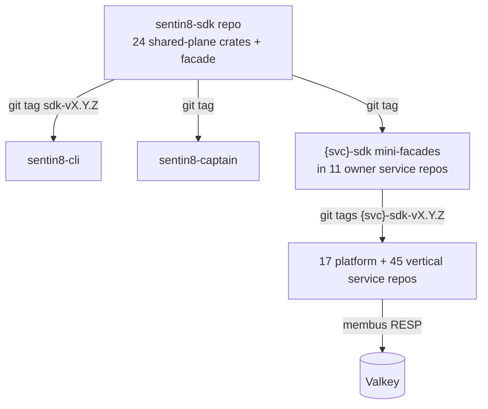
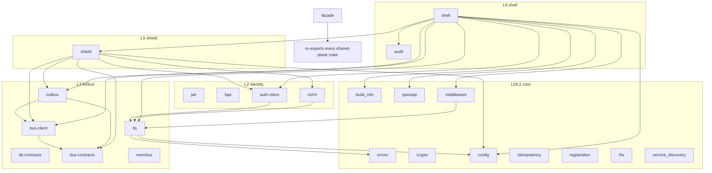
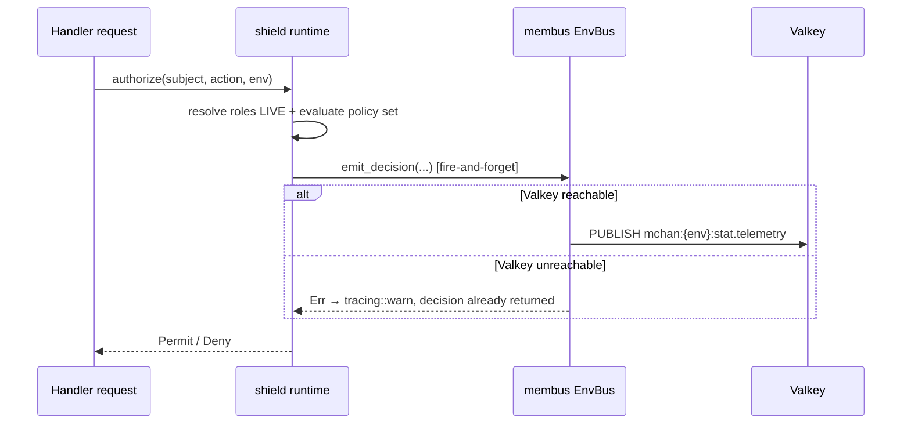
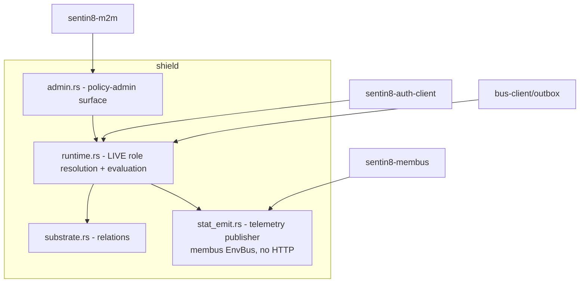
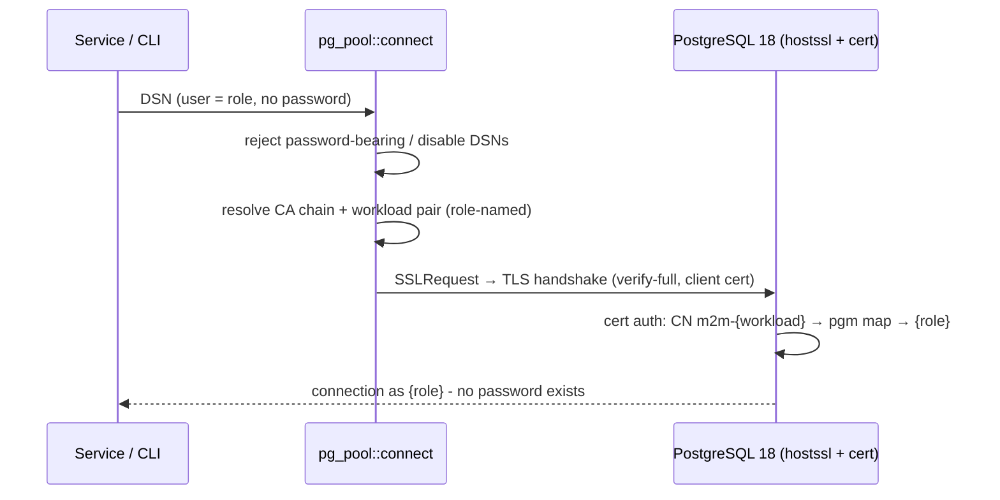
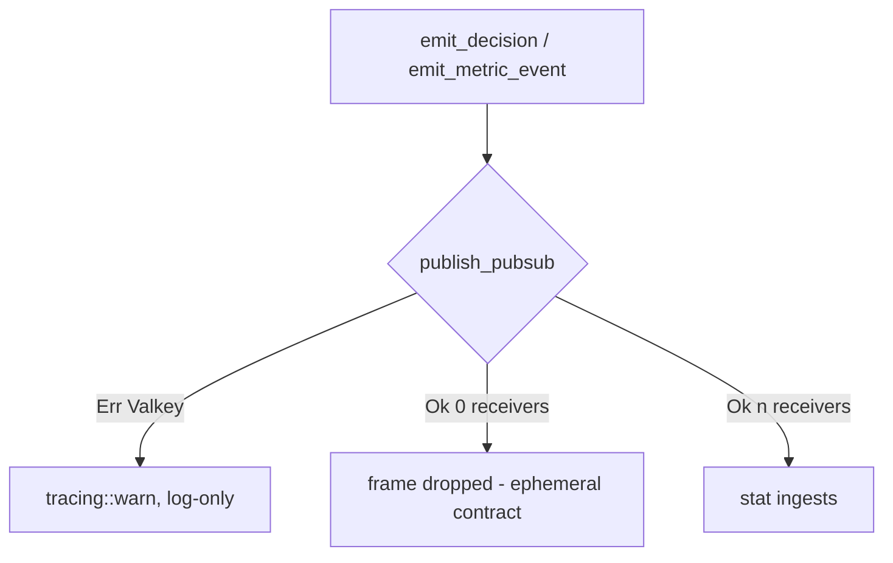
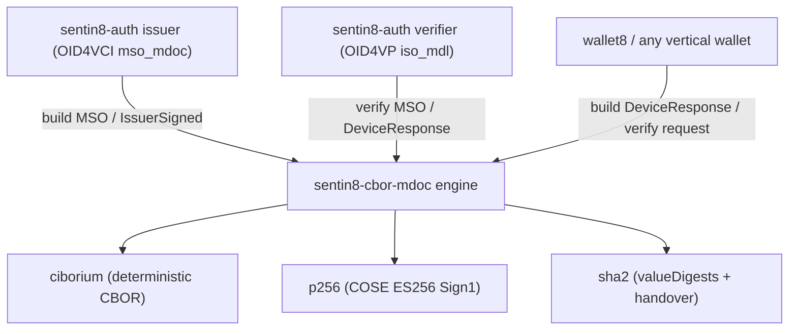
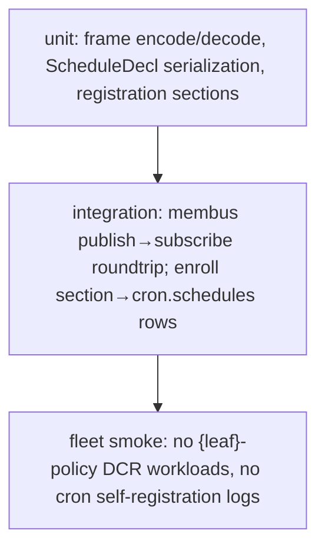

# sentin8-sdk - Detailed Design Document

> Audience: maintainers, reviewers, and architects modifying the shared
> library workspace. For overview read `README.md`; for business
> capabilities read `BUSINESS.md`. Design of record:
> `../../design/sentin8-sdk-dependency-cleanup-design.md` (SDD) - this
> document implements its §2 and §3 for the SDK repo.

## 1. Scope & Context

### 1.1 What the SDK repo owns

- **24 shared-plane crates** (SDD §2.1): core ×10 (errors, crypto, config,
  build-info, idempotency, registration, rfw, openapi, middleware,
  service-discovery), identity ×4 (jwt, fapi, m2m, auth-client), tls ×2
  (tls, tls-contracts), bus ×4 (bus-contracts, bus-client, membus, outbox),
  shield ×1, shell ×2 (shell, audit), facade ×1 (`sentin8`).
- **The telemetry helper** - shield's `stat_emit` module generalized to
  the shared `stat.telemetry` MemBus publish path used by shield
  (policy decisions + shared metric emission) and by services emitting
  metric frames directly (auth/ai/app/email8-mta class).
- **`ScheduleDecl`** in `core/registration` - the declarative schedules
  section consumed by `sentin8-cli vertical enroll`.

### 1.2 What it explicitly does NOT own

- Service-scoped SDK crates - every `{svc}-client`/`{svc}-contracts`
  crate lives in its owner service repo behind a mini-facade
  (`sdk/`, package `sentin8-{svc}-sdk`).
- Service binaries, service registration files, vertical knowledge of
  any kind (architecture-principles §4.14).
- Scheduled work execution - Cron's ticker owns firing; the SDK only
  declares the schema for enrollment.

### 1.3 System context



### 1.4 Container view



## 2. Runtime Architecture

### 2.1 The telemetry publish path (replaces the stat-client edge)

`shield/src/stat_emit.rs` - public API unchanged, transport changed:

| Function | Before | After |
|---|---|---|
| `init_stat_emitter_for_service(service)` | builds `StatClient` + `{leaf}-policy` M2M DCR | builds `MemBus::for_env` handle for the `stat.telemetry` family |
| `emit_decision(service, subject, action, enforced, reason, set)` | `collect_fire_and_forget` HTTP | `EnvBus::publish_pubsub` frame |
| `emit_metric_event(service, name, metrics, props)` | HTTP | `publish_pubsub` frame |

The frame payload is flat JSON matching stat's ingest contract
(`EventEnvelope` fields: `client_id` = service, `client_type` = `"server"`,
`property_slug` = short name, `event_name`, `metrics`, `props`,
`subject_id?`, `timestamp`). Publish failure → log-only (tracing::warn),
never fatal - the decision path is unaffected by a Valkey outage.

### 2.2 Request lifecycle - policy decision emission



### 2.3 Component view - shield after the change



## 3. Data Model

The SDK repo owns no tables. It defines the wire types consumed at enroll
time (`core/registration`):

```rust
pub struct ScheduleDecl {
    pub schedule_type: &'static str,
    pub cron_expression: &'static str,  // 5-field
    pub timezone: &'static str,         // default "UTC"
    pub target_config: serde_json::Value,
    pub max_retries: u32,
}
```

`Registration.schedules: &[ScheduleDecl]` - serialized by
`--print-registration --section=schedules`; the CLI upserts
`cron.schedules` rows (env-scoped, `schedule_type` unique per
(env, domain)).

### 3.1 MemBus frame (telemetry class)

```text
channel:  mchan:{env_id}:stat.telemetry
envelope: et  = sentin8:stat:telemetry:emitted
          ts  = unix_micros
          cid = correlation_id (when known)
          by  = producer service short name
          sq  = per-(service, family) sequence
          p   = JSON EventEnvelope fields (flat)
```

## 4. API Surface

Public crate APIs are unchanged except:

- **facade**: the service modules (`flow`, `cron`, `stat`, `storage`,
  `func`, `db`, `ai`, `sys`, `app`, `bff`, `secrets`) and the legacy
  hand-rolled `AuthClient`/`Db8Client` types delete. `sentin8::auth`
  keeps `client`/`jwt`/`m2m`/`fapi`; `sentin8::tls`, `sentin8::bus`
  keep their shape.
- **shield**: `stat_emit` functions keep signatures; the transport is
  internal.
- **registration**: gains `ScheduleDecl` + `Registration.schedules` +
  `--section=schedules` output.

No endpoint changes; the SDK ships no servers.

## 5. Cross-Cutting Concerns

- **Authentication**: `m2m` + `auth-client` unchanged - cert-bound
  (RFC 8705) cached token sourcing; the SDK itself performs no DCR for
  telemetry (MemBus needs none - tenant isolation by key derivation).
- **Outbox relay rate-limit discipline **: a retryable produce
  failure (429/5xx/transport) sets the row's `next_retry_at` (Bus's 429
  body carries `retry-after: 60`; other retryables take the 2s tick) and
  the drain predicate skips rows whose `next_retry_at` is in the future.
  A burst backlog then drains at the Bus rate limit instead of burning
  the 10-attempt budget against it; permanent 4xx keeps parking
  immediately. The `next_retry_at` column ships in the shared
  `outbox_table_sql` DDL (greenfield - no migration).
- **Tenant resolution**: unchanged; telemetry frames carry no env in the
  payload - the channel key derives from the `EnvBus` binding.
- **Idempotency**: MemBus `sq` per-(service, family) sequence for
  dedupe/gap detection.
- **Audit**: unchanged - the shell's audit push loop (§6.8 journal→Sys)
  is untouched.
- **TLS**: `sentin8-tls` post-quantum posture unchanged.
- **PostgreSQL certificate identity (group DESIGN.md §3.2)**:
  `core/config`'s `pg_pool` module is the fleet's ONE connection factory -
  every service pool AND the CLI/operator tooling route through it.
  `connect_options_for` builds the transport: `ssl_mode(VerifyFull)`
  (forced; `sslmode=disable` rejected - no plaintext listener exists),
  the published Acme root+intermediate chain as `ssl_root_cert`, and the
  workload's m2m client pair (`ssl_client_cert_from_pem` /
  `ssl_client_key_from_pem`) resolved by ROLE name - `sentin8_*_service`
  roles read the pair named after the binary/workload identity, the DDL
  role `sentin8` reads the fixed `postgres-ops` infra pair. A DSN whose
  userinfo carries a password is REJECTED at construction: the plane is
  passwordless by design, and a half-converted DSN is a configuration
  error, not a degraded mode. sqlx compiles TLS support via the
  `tls-rustls-ring` feature (without it sqlx links NO TLS backend and
  every TLS DSN fails with "server does not support TLS").



## 6. Failure Modes & Recovery



- **Valkey down**: log-only; no retry queue (loss-tolerant class by
  contract - "non-important updates").
- **No live subscriber**: frame gone (Pub/Sub contract); stat outage =
  telemetry loss, never a decision failure.
- **Pool/conn**: `EnvBus` clones the shared multiplexed command
  connection - no per-emit connection churn.

## 7. Concurrency & Performance Model

- Init-once: `OnceLock<Option<Arc<EnvBus>>>` replaces the old
  `OnceLock<Option<Arc<StatClient>>>` - emit path remains lock-free.
- Emit is fire-and-forget on the shared command connection; no dedicated
  subscriber connections on the producer side.
- Hot paths (policy evaluation) unchanged; emission adds one RESP PUBLISH
  (~µs class) per decision/event.

## 8. Invariants, Insecure-Defaults Rejected, Unsafe Rationale

- ****: placement by shared-plane linkage; the shared plane links no
  service-scoped client - a future need is a design defect, route through
  MemBus/domain events.
- ****: facade never re-exports a mini-facade.
- **(identity/m2m → workload-identity)**: the platform M2M plane
  carries NO token. The crate's job narrows to certificate identity
  management: mint-if-missing from Acme (bootstrap-enrollment channel),
  persist the `{workload}.crt/.key` pair (0700/0600), and provide the
  cert-presenting HTTP client builders consumers dial each other with.
  The token source, DCR helper, credential cache (`dcr_*.json`), boot
  probe, scope-drift re-registration, and 401 self-heal machinery are
  DELETED (their synchronization burden - cache vs `oauth_clients` vs
  JWT - was the recurring DB-reset 401 storm's root cause; the TLS
  handshake already proves possession on every call). Authorization
  inputs travel via the enroll-published `m2m:workloads` Valkey hash
  (workload → {vertical, service_type, scopes, enabled}), boot-loaded +
  TTL-cached by every service, fed into Shield `RequestCtx` and Bus's
  vertical gate; revocation = `enabled=false`, observed within the
  cache TTL. JWTs remain for user/delegated flows; DCR remains for
  interactive + out-of-band tenant clients.
- **(tls → cert cache)**: minted server leaves are caller-custodied
  artifacts exactly like the workload client pairs - persisted under
  `{SENTIN8_SECRETS_DIR}/tls-certs/` (0700/0600) and pre-warmed at boot with
  expiry pruning and a hostname cap (`SENTIN8_TLS_CERT_CACHE_MAX`, default
  256; the SNI key space is client-controlled). The on-demand Acme mint
  remains the fallback for genuinely new hostnames; the prewarm path is a
  LOCAL DISK READ ONLY (no new boot-time cross-service edge - runtime
  dependency discipline). Revocation is honored at natural expiry/re-mint
  (dev posture; the Storage-backed revocation-list seam is the production
  path). The `acme` crate gains the matching reuse-before-mint rule at
  finalize (acme DESIGN §4.0) so re-requests are idempotent.
- No `unsafe` in the SDK plane (`facade` forbids it; membus uses only
  safe RESP APIs).
- Rejected: durable Streams for telemetry (imposes retry/DLQ semantics on
  a loss-tolerant class); stat-client with a "disabled" flag (keeps the
  DAG inversion the cleanup removes); feature-gated facade (one ring,
  facade with service knowledge); keeping the M2M token as a "second
  proof" (it was the storm's root cause and adds no strength beyond the
  handshake's possession proof).

## 8b. The mdoc engine (`sentin8::mdoc`, ISO/IEC 18013-5/-7)

**Scope.** The platform's single ISO 18013-5 engine - Mobile Security
Object (MSO) build and verify, the IssuerSigned document form, the
DeviceResponse presentation form, and the OID4VP handover transcripts.
One engine serves all three roles: the sentin8-auth ISSUER (mso_mdoc
credential configurations, OID4VCI), the sentin8-auth VERIFIER (DCQL
`mso_mdoc` queries + vp_token acceptance, OID4VP), and every vertical
WALLET via the facade (`sentin8::mdoc`, wallet8 first). The engine
lives in the SDK because the dependency rule is one-way: auth builds
on the SDK, verticals build on both - the mdoc binary format must not
exist twice.



**The wire forms the engine owns.**

- `IssuerSigned` (ISO 18013-5 §8.3, the VCI credential response): CBOR
  map `{nameSpaces, issuerAuth}` where `issuerAuth` is COSE_Sign1
  (alg -7/ES256) whose payload is the MSO (`docType`, `valueDigests`,
  `validityInfo` tdate `Z` values, `deviceKeyInfo.deviceKey` JWK) and
  whose protected header carries `x5chain` (the DS certificate). The
  digests: every IssuerSignedItem's `SHA-256(CBOR(item))` lands in
  `valueDigests[namespace][digestID]`.
- `DeviceResponse` (ISO 18013-7 §6, the OID4VP vp_token entry): the
  unpadded-base64url CBOR MAP `{version: "1.0", documents: [...],
  status: 0}` (the ISO map form - the verifier's multipaz
  DeviceResponseParser reads the `version`/`documents` map members;
  the parse side also accepts the legacy
  `[version, [{status, documents}], status]` ARRAY form, the builder
  only emits the map). One Document: `{docType, issuerSigned,
  deviceSigned}` where `deviceSigned = {nameSpaces:
  #6.24(bstr(empty DeviceNameSpace map)), deviceAuth:
  {deviceSignature: COSE_Sign1}}` - the DETACHED `deviceSignature`
  (null payload) covers `Sig_structure["Signature1", {1: -7},
  external_aad(empty), #6.24(bstr(DeviceAuthentication))]`, and the
  `DeviceAuthentication` array is `"DeviceAuthentication" |
  sessionTranscript (RAW embedded CBOR item) | docType (canonical
  tstr) | deviceNameSpaces` - the 4th element is the
  **DeviceNameSpaceBytes ITSELF, the #6.24(bstr(...)) TAG wrapping**
  the empty DeviceNameSpace map (ISO 18013-5 CDDL:
  `DeviceNameSpaceBytes = #6.24(bstr .cbor DeviceNameSpace)`). The
  verifier's multipaz parser appends the RAW
  `deviceSigned["nameSpaces"]` DataItem to the DA array
  (DeviceResponseParser.kt), so the signed bytes carry
  `d8 18 41 a0` - embedding the DECODED map (`a0`) desynchronizes the
  signature and lands "device-signed data was neither properly MACed
  nor signed by a DeviceKey". The docType rides the canonical tstr
  head (0x60+len for <=23 bytes, 0x78+len for 24..255).
- The SessionTranscript forms (OID4VP 1.0 Final Appendix B.2.6.1/6.2):
  the redirect handover `[client_id, nonce, jwkThumbprint|null,
  response_uri]` and the dc_api handover `[origin, nonce,
  jwkThumbprint|null]` - both wrapped `[null, null, Handover]` with
  the `"OpenID4VPHandover"|"OpenID4VPDCAPIHandover" |
  SHA-256(HandoverInfo)` shape. The encoder emits MINIMAL
  definite-length heads ONLY (`0x60+len` / `0x78+len` / `0x79+u16`
  for tstr, `0x40+len` / `0x58+len` / `0x59+u16` for bstr): a
  non-minimal head (a two-byte length form of a <=23-byte string,
  e.g. `78 11` for "OpenID4VPHandover") desynchronizes the byte-exact
  transcript the verifier re-derives and breaks the device signature.
  The handover thumbprint covers the VERIFIER's response-encryption
  JWK whenever `client_metadata.jwks` carries an EC JWK whose alg is
  a key-agreement/encryption alg - the JWK `use` member is OPTIONAL
  (OID4VP 8.3; the suite's "encryption parameters without use" row):
  requiring `use: "enc"` hashes the UNENCRYPTED HandoverInfo while
  the verifier hashes the ENCRYPTED one.
- The 18013-7 status forms: `status` on the MSO is optional; present it
  must be `status_list {idx, uri}` or `identifier_list {id, uri}`.

**The disclosure rule (OID4VP 6.4.1).** The wallet releases ONLY the
claims the DCQL query reaches: `filter_issuer_signed` re-encodes the
stored `IssuerSigned` keeping the issuerAuth and the allowlisted
`(namespace, elementIdentifier)` IssuerSignedItems (dropping an item
is always legal - the MSO digest coverage is per item, so the
retained items still verify issuer-side). The filter is form-tolerant
both ways: the `nameSpaces` member arrives PLAIN (the mock-issuer
mint: `{ns -> [item...]}`) or Tag24-wrapped (ISO canonical:
`#6.24(bstr({ns -> [#6.24(bstr(item))]}))`), items arrive plain or
Tag24-wrapped - the filter drops in place and preserves whatever
shape the holding carried. A claims-LESS DCQL query ("the wallet MUST
NOT disclose anything selectively disclosable") discloses NOTHING:
the caller passes a no-match allowlist and every namespace drops
out. The IssuerSignedItem `salt` member reads with the `random`
alias (the suite's mint names the field `random`; serialization
stays `salt`).

**Key members.** `MsoBuilder` (doc_type, namespaces, device JWK,
validity window, status -> MSO + IssuerSigned CBOR), `verify_mso`
(COSE_Sign1 x5chain + digest coverage), `build_device_response` (the
ISO map DeviceResponse + the detached deviceAuthentication
signature), `parse_device_response` (the map form + legacy array
fallback -> ParsedDocument/disclosed_claims), `filter_issuer_signed`
(the 6.4.1 claim filter), the transcript calculators
(`redirect_transcript`, `dc_api_transcript`, `jwk_thumbprint_raw`).
The engine holds NO storage, NO HTTP -
pure codecs and crypto; the roles own their I/O.

**Invariants.** (1) Deterministic CBOR encoding at every digest site -
the digest is over the exact item bytes the wallet re-derives (a
length-first map ordering mismatch = the suite's
ValidateMdocIssuerSignedItemDigests failure). (2) The MSO timestamps
are tdate - second precision, `Z`, no fractions. (3) The x5chain leaf
is the DS certificate whose curve pairs with the COSE alg (ES256 ->
P-256). (4) The device key in the MSO is the key the proof
demonstrated (RFC 7638 thumbprint equality, the suite's
VCIEnsureMdocDeviceKeyMatchesProofKey). (5) The DA's nameSpaces
element is the TAGGED DeviceNameSpaceBytes - never the decoded map -
and every transcript member head is MINIMAL canonical CBOR: both
bytes feed the device signature the verifier re-derives byte-exactly
(a drift = "neither properly MACed nor signed"). (6) The detached
deviceSignature payload is null - the verifier rebuilds the payload
from its own DA derivation; embedding any payload double-binds the
signature.

**Rejected alternatives.** A per-role implementation (issuer-side in
auth, wallet-side in wallet8 - duplicates the digest/transcript logic
and diverges); multipaz-style full 18013-7 stack (the suite demands
exactly the two wire forms above - a full stack imports a surface the
certification never exercises); COSE via the `coset` crate (its
COSE_Sign1 shape does not carry x5chain without extensions - the
engine builds the Sign1 headers directly over ciborium).

## 9. Testing Strategy



- Unit: `stat_emit` frame shape; `schedules` section serialization;
  facade re-export surface (compile test).
- Integration: membus roundtrip in the SDK workspace tests; CLI enroll
  provisioning covered in `sentin8-cli`'s tests.
- Deliberately NOT tested here: stat ingest correctness (stat repo),
  cron firing (cron repo), BFF web/mobile ingest (unchanged contract).

## 10. Open Questions

- Frame-schema registry for payload validation at decode - deferred.
- Pin-freshness automation for per-service sdk tags - aggregation CI.

---

**Architecture & Design:** sentin8 and its underlying concepts were designed by [Hamid Jahanzad](https://www.linkedin.com/in/hamidjahanzad/).
