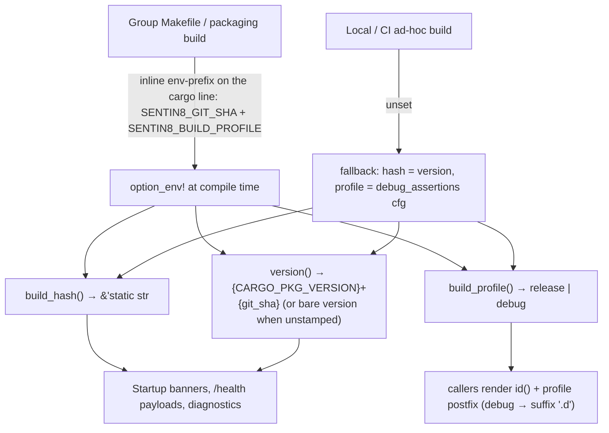

# Design Doc: sentin8-build-info (Compile-Time Build Identity)

## 1. Summary

`sentin8-build-info` exposes the compile-time identity of a Sentin8
binary: the **build hash** (source revision stamp), the **service
version** (`{CARGO_PKG_VERSION}+{git short hash}`), and the **build
profile** (`"release"` / `"debug"`, rendered by callers as a `.d`
postfix on debug builds). Every Sentin8 service surfaces the identity
in its startup banner and `/v1/health` payload so operators can verify
WHICH binary runs — per instance, per profile.

## 2. Motivation

- Operators and support tooling need to know **what is running**, not just
  what is deployed: rolling upgrades mean different instances of the same
  service can run different builds simultaneously, and a dev fleet's
  debug binary must be distinguishable from a release binary of the same
  commit at a glance.
- A bare `0.1.0` tells the operator nothing about WHICH source state is
  running; the git short hash pins the version to a commit in the owning
  repository.
- The identity must exist in *every* build environment (packaged .deb,
  local debug builds, CI) without requiring a git checkout or network
  access at build time — the *build system* (group Makefile, packaging
  rules) resolves the stamp, the crate never shells out to `git`.

## 3. Architecture & High-Level Design

Stamp resolution orders:

1. **Build hash**: `SENTIN8_BUILD_HASH` env var — set by the packaging
   build from the package version + timestamp (or manually for
   reproducible builds); fallback `CARGO_PKG_VERSION`.
2. **Git short hash**: `SENTIN8_GIT_SHA` env var — set by the group
   Makefile targets (`git rev-parse --short HEAD` of the repo being
   built) and by the packaging build; fallback: omitted from the
   rendered version.
3. **Build profile**: `SENTIN8_BUILD_PROFILE` env var (`release` /
   `debug`) — set by the group Makefile targets to match the active
   cargo profile; fallback: the `debug_assertions` cfg (the
   compile-time signal the binary itself carries into its profile).

**Delivery shape (the `stamp_env` inline env-prefix).** The stamps ride
the SAME shell line as the cargo command — a single-space env-prefix
like `SENTIN8_GIT_SHA=$$(git rev-parse --short HEAD) $(CARGO) build …`.
Make runs each recipe LINE in its own shell, so any
`export …` line issued before the cargo line evaporates before cargo
starts (the BUILDID-1 delivery shipped as a standalone multi-line
`define` whose exports never reached a single build — every binary in
the fleet rendered `0.1.0 (build unknown)` until STATUSID-1). The
shell-side `$$()` substitution (not make's `$(shell)`) keeps the
resolution working inside recipe loops. The hash resolves via PLAIN
`git rev-parse` from the shell's cwd — the prefix expands AFTER the
recipe's `cd` into the repo being built, so a repo-relative `git -C
{repo}` would resolve from INSIDE the repo and miss (the first
STATUSID-1 iteration did exactly that, stamping every binary EMPTY —
the empty stamp is treated as unstamped by `version()`, and the CLI
banner renders `unknown`, never a blank). Every cargo invocation
through a group Makefile — builds, `test`, and the `cargo run`
control paths (`start`/`stop`/`status`/`enroll`) — carries the prefix:
cargo fingerprints `option_env!`, so an unstamped `cargo run` would
otherwise REBUILD the binary back to an unstamped identity after a
stamped build (a flip-flop). Ad-hoc builds outside the Makefiles are
unstamped by design (bare-version fallback).

## 4. Key Traits and Data Structures

- **`build_hash() -> &'static str`** — a `const fn`, so the value can be
  used in `const` contexts (static startup banners, embedded payload
  fields) as well as runtime expressions.
- **`version() -> &'static str`** — the full service identity:
  `{CARGO_PKG_VERSION}+{SENTIN8_GIT_SHA}` when the stamp is present,
  bare `{CARGO_PKG_VERSION}` otherwise. Also a `const fn`.
- **`build_profile() -> &'static str`** — `"release"` or `"debug"`; a
  `const fn`.
- **`id() -> String`** — `{version()}` plus the debug marker: an empty
  postfix on release, `".d"` on debug (`"0.3.0+5f3a9c1.d"`). The one
  call site for banners and health payloads; allocates (not a `const
  fn`) but is evaluated once per banner/health hit.

## 5. Rationale, Trade-offs, and Alternatives

- **`option_env!` over build-script git invocation.** A build script that
  shells out to `git` couples compilation to a repository checkout — it
  breaks packaged source builds, vendored builds, and reproducible builds.
  `option_env!` keeps the crate hermetic; the build system (group
  Makefile per-repo loop, packaging pipeline) resolves and injects the
  stamp — the same division of labor the build hash already uses.
- **Version fallback over error.** `env!("CARGO_PKG_VERSION")` guarantees
  a non-empty, meaningful identity in every environment without failing
  compilation; a hard error would break all ad-hoc builds.
- **`debug_assertions` cfg as the profile fallback.** An ad-hoc `cargo
  build` outside the Makefile still reports the correct profile because
  the flag is baked into the binary by the cargo profile itself — no
  coordination with the build system required. An explicitly stamped
  `SENTIN8_BUILD_PROFILE` stays the primary (a cross-profile cached
  artifact still carries its own honest signal).
- **`.d` rendered by callers, not baked into `version()`.** The version
  string stays a pure `{version}+{hash}` identity (parseable, sortable);
  the profile marker is a *display* concern of the banner/health
  renderer. Baking it in would make the CLI's `{version}.{build_hash}`
  collapse logic and any semver-ish parsing see the marker as part of
  the version.
- **`const fn` over lazy static.** The value is known at compile time by
  construction; a runtime initializer adds nothing but cost.

## 6. Internal Implementation & Invariants (Private Design)

- **Invariants:**
  - `build_hash()` and `version()` never return an empty string.
  - Both values are stable for the lifetime of the process (compile-time
    constants).
  - When `SENTIN8_BUILD_HASH` is unset at compile time, the build hash
    equals `CARGO_PKG_VERSION`.
  - When `SENTIN8_GIT_SHA` is unset at compile time, `version()` equals
    `CARGO_PKG_VERSION` exactly (no dangling `+`).
  - `build_profile()` is exactly one of `"release"` / `"debug"` in every
    build.
  - `id()` ends with `.d` **iff** the build profile is `debug`.
- **No runtime dependency** on environment, filesystem, or git — once
  compiled, the identity is fixed.

## 7. Unresolved Questions / Future Designs

- None currently. (The former open question — a source-revision stamp —
  is resolved by `SENTIN8_GIT_SHA` + `version()`.)

---

**Design attribution:** sentin8:build-info and its underlying concepts were designed by Hamid Jahanzad <Hamid@Jahanzad.com>.
