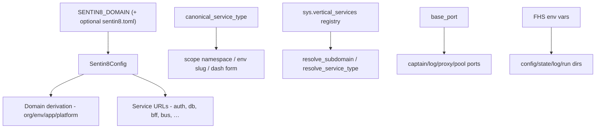

# Design Doc: sentin8-config (Domain Derivation & Platform Configuration)

## 1. Summary

`sentin8-config` is the single source of truth for platform configuration:
domain derivation from the root `SENTIN8_DOMAIN`, system UUIDs, port
layout, FHS paths, service-identity naming, subdomain resolution from the
runtime registry, PostgreSQL/Valkey connection defaults, and log
destination parsing. Every service derives its domains and endpoints
through this crate - nothing hardcodes a hostname.

## 2. Motivation

- **One root, every domain.** The uniform hierarchy
  `{service}.{env}.{org}.{tld}` must be derived identically in every
  process (services, CLI, proxy, TLS resolvers). A single crate prevents
  per-service drift in hostname construction.
- **Runtime-configurable fleet.** Ports, directories, and database
  endpoints must be re-shardable via environment variables without
  recompiling anything.
- **Identity normalization.** Service identities arrive in several shapes
  (colon identity, dash form, worker suffixes); one canonical normalizer
  keeps registries, scopes, env slugs, and DNS labels consistent.

## 3. Architecture & High-Level Design

Components:

- **Constants** - `SYSTEM_ORG_ID` / `SYSTEM_ENV_ID` (fixed UUIDs `…0001` /
  `…0002`), slugs (`sys`, `ops`), `DEFAULT_SENTIN8_DOMAIN`.
- **Port layout** - `base_port()` + fixed offsets (captain +0, log UDP +1)
  and an auto-assigned service pool (`base+2 … base+101`); the proxy is a
  well-known port (443), not a base offset.
- **FHS paths** - config/state/log/run directories with production
  defaults (`/etc/sentin8`, `/var/lib/sentin8`, …) overridable for dev
  builds.
- **`Sentin8Config`** - the root-domain holder with derivation helpers
  (`org_domain`, `env_domain`, `app_domain`, `platform_domain`) and
  service URL builders; layered loading via figment (TOML base → env
  override).
- **Identity functions** - `canonical_service_type` (any accepted input →
  colon identity), worker detection/base stripping, dash form, env slug,
  and scope namespace.
- **Registry resolution** - `resolve_subdomain`, `resolve_service_type`,
  `load_subdomain_map` (+ transaction-scoped variants) reading
  `sys.vertical_services`.
- **Typed newtypes** - `OrgDomain`, `EnvDomain`, `AppDomain` with
  per-service subdomain builders.
- **`pg_pool`** - the fleet-standard connection pool sizing (capped).
- **`dns`** - DNS profile knobs (config surface only).
- **`bootstrap`** - the captain-brokered enrollment credential contract
  that lets a first-boot workload mint its identity from Acme.

## 4. Key Traits and Data Structures

- **`Sentin8Config`** - built via `from_env()` (TOML + env layers) or a
  builder (tests). Holds only the root domain; everything else derives
  from it deterministically.
- **`DatabaseOAuthConfig`** - per-service PostgreSQL 18 OAuth settings
  (token URL, DCR client id/secret, scopes) loaded from
  `DATABASE_*` env vars; `None` falls back to password auth.
- **`LogDestination`** (`log:udp`, `log:ws`, `local:disk`) with strict
  parsing - unknown values fail fast at startup rather than silently
  degrading observability.
- **`OrgDomain` / `EnvDomain` / `AppDomain`** - thin validated wrappers
  with `{service}`-specific subdomain builders at the right scope.
- **`canonical_service_type(token)`** - the identity normalizer:
  `sentin8-auth` → `sentin8:auth`, `bank8:payments:w` →
  `bank8:payments:worker`; colon identities pass through unchanged.

## 5. Rationale, Trade-offs, and Alternatives

- **Derivation over a domain table.** Every hostname is computed from the
  root + slugs, so no database row is needed to construct a URL - only to
  *resolve* a service's subdomain (the registry query). A fully table-driven
  approach would make even construction async and couple every startup to
  a DB query.
- **Registry-backed subdomain resolution with fallback.**
  `sys.vertical_services` is the runtime source of truth for service →
  subdomain; unknown labels fall back to the dash-form web service (app
  instances are served by web, and app hostnames never appear in the
  service registry).
- **The registry fallback is always DNS-valid.** The fallback for a
  service identity that the registry query could not see (RLS-scoped
  connection, brand-new vertical before enroll converges) must be the
  **dash form** of the identity (`bank8:fdx` → `bank8-fdx`), never the raw
  colon form. A colon in a hostname is not a valid DNS label: browsers
  reject `location.href = "https://bank8:fdx.…"` outright (SyntaxError -
  the colon parses as a port separator in the authority), TLS SNI cannot
  match it, and the proxy has no route for it. The class-defining failure
  this rule prevents: an OAuth `redirect_uri` built from the fallback
  (`https://bank8:fdx.prod.{org}.…/fdx/consents/callback`) is registered
  at DCR, survives the whole PAR/authorize flow, and only detonates
  client-side at the consent page's final navigation - unreachable from
  any server-side log except the browser console. Observed live (auth-ui
  consent page): `Failed to set the 'href' property on 'Location': … not a
  valid URL`, the page fell into its catch-fallback `/oauth/authorize?…
  &consent=granted`, and Auth 400'd the PAR-less re-entry - the FDX
  consent flow stalled mid-approve with the customer stuck on the auth
  domain.
- **Layered config (figment: TOML → env).** Deployment-provisioned TOML
  gives operators a single file; env vars override per process without
  editing files. The order is fixed and simple - no merge ambiguity.
- **`KEYS`-free, query-light design.** The registry helpers issue one
  scalar query per call and provide in_tx variants so callers inside a
  context-carrying transaction reuse the connection (RLS on
  `sys.vertical_services` + idle-in-transaction pool exhaustion are both
  addressed by the caller-managed-transaction pattern).
- **Pool cap of 3 (`pg_pool`).** ~20 services × several instances each
  would exhaust PostgreSQL's connection limit with default pools; a fleet
  cap keeps steady state well under the limit. Overridable per deployment
  via `SENTIN8_PG_POOL_MAX`.
- **Fail-fast log-destination parsing.** A typo in `SENTIN8_LOG_DESTINATIONS`
  panics at startup - silently degraded observability is worse than a
  failed boot.
- **Rejected: per-service hardcoded ports.** The base-port + offset +
  auto-pool layout re-shards the whole fleet with one env var; fixed
  per-service ports would collide on shared hosts and complicate rolling
  upgrades.

## 6. Internal Implementation & Invariants (Private Design)

- **Invariants:**
  - `SYSTEM_ORG_ID` / `SYSTEM_ENV_ID` are fixed well-known UUIDs and
    distinct; the platform tables and RLS context depend on them.
  - All derived domains are lowercase DNS labels; the colon identity's
    `sentin8:` prefix is dropped in DNS form (`sentin8:auth` → `auth.…`),
    while vertical identities keep their vertical label
    (`bank8:ledger` → `bank8-ledger.…`).
  - `service_scope_namespace` always starts with the vertical - the
    platform vertical gets no special case.
  - Env slugs are derived from the *base* identity (workers share the
    base's port env vars).
- **Transaction-scoped registry variants** exist because
  `sys.vertical_services` carries tenant RLS: queries inside a
  context-carrying transaction must run on that transaction's connection,
  never a pooled one (a pooled query has no tenant context → RLS-filtered
  → wrong fallback, and leaks an open transaction per miss).
- **`valkeys://` scheme gate** - the factory in `sentin8-middleware`
  accepts only the `valkeys://` TLS scheme; any other scheme (including
  plaintext) is a configuration error. There is no plaintext path.
- **PostgreSQL version gate** is build-mode dependent: release builds hard
  fail below the minimum version; debug builds warn and continue so dev
  images can lag.

## 7. Unresolved Questions / Future Designs

- Config currently carries only the root domain; grow on demand with the
  established pattern (every new key gets a default, an env override, and a
  test).
- Custom-domain validation (wildcard coverage checks per org domain) stays
  out: the crate is a pure domain-derivation layer; cert issuance covers
  validation.
- The auto-assign port pool is per-host; a multi-host fleet sharding scheme
  can be encoded as a config key (`port_pool_base` per host) when a multi-host
  deployment exists.

---

**Architecture & Design:** sentin8:config and its underlying concepts were designed by [Hamid Jahanzad](https://www.linkedin.com/in/hamidjahanzad/).
