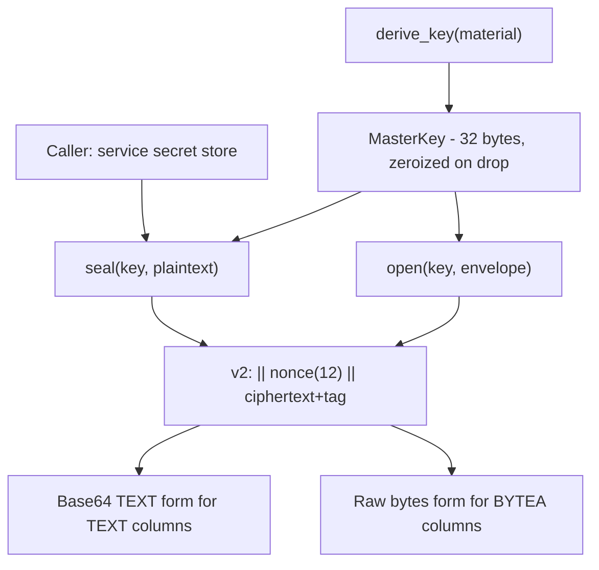

# Design Doc: sentin8-crypto (At-Rest Secret Encryption)

## 1. Summary

`sentin8-crypto` provides AES-256-GCM authenticated envelope encryption for
secret material stored in application tables (OAuth signing keys, DCR
client secrets, IdP client secrets, webhook signing secrets, TOTP secrets).
It is the single shared codec for the platform's "secrets by reference /
by ciphertext" rule: plaintext secrets never live in application tables.

## 2. Motivation

- **Plaintext is the default failure mode.** Service code that stores a
  provider token or client secret as a plain column value is the most
  common secret-leak vector (DB dumps, backups, logs of query results).
  A tiny, auditable codec with a mandatory envelope prefix makes encrypted
  storage the path of least resistance.
- **Tamper evidence.** AES-GCM's authentication tag rejects wrong-key
  decryption and modified ciphertext with one error, so corrupt rows fail
  closed instead of returning garbage.
- **Key hygiene.** The master key is held in a zeroizing wrapper and
  never leaves the process; secrets are derived from a single operator
  provisioning step.

## 3. Architecture & High-Level Design



Envelope format - Base64 (standard) of:

```text
"v2:" || nonce (12 bytes) || ciphertext-with-tag
```

- The 12-byte nonce is random per encryption (AES-GCM standard size).
- No AAD: the table row (service, record id) provides the surrounding
  context; per-row AAD would couple the crate to table schemas.
- TEXT columns hold the Base64 of the raw envelope; BYTEA columns hold the
  raw envelope bytes. Both forms decode with the same `open` call.

## 4. Key Traits and Data Structures

- **`MasterKey`** - exactly 32 bytes, wrapped in a zeroizing container.
  `from_bytes` (raw 32 bytes), `from_base64` (operator provisioning format;
  `None` for empty input so callers can apply fail-closed logic), and
  `derive_key` (SHA-256 for passphrase-style material).
- **`seal` / `seal_raw`** - encrypt into the Base64 TEXT form / raw BYTEA
  form respectively.
- **`open` / `open_str`** - decrypt either form; the raw form is recognized
  by the literal `v2:` prefix and the TEXT form by Base64 decoding (a
  Base64 encoding of `v2:` always begins `djI6`, so the two forms are
  unambiguous).
- **`is_envelope` / `is_envelope_str`** - prefix check used by callers to
  detect un-encrypted rows and encrypt them on first read.
- **`CryptoError`** - key-length, base64, envelope-structure, and
  authentication failures.

## 5. Rationale, Trade-offs, and Alternatives

- **AES-256-GCM.** Standard authenticated encryption with hardware support;
  no key schedule cost concerns at this message scale. Rejected
  alternatives: ChaCha20-Poly1305 (equivalent security; no advantage here),
  HKDF+column-key-per-tenant (more key management than the platform's
  single-master-key provisioning supports today).
- **Random 12-byte nonce per encryption** - the AES-GCM standard choice.
  A deterministic nonce (hash of plaintext) would leak equality and invite
  nonce-reuse bugs under concurrent writes; `OsRng` nonce costs 12 bytes.
- **Prefix-tagged versioned envelope (`v2:`).** Versioned prefixes let the
  codec evolve (e.g. a future `v3:` with AAD or key IDs) while old rows
  remain readable, and give callers a cheap discriminator for un-encrypted
  data without a schema change.
- **No key rotation API in this crate.** Rotation is a caller-level concern
  (re-seal rows under the new key). Embedding multi-key decryption would
  add key-ID plumbing to every envelope for a rotation cadence the platform
  does not yet have.
- **`Zeroizing` master key.** The key material is scrubbed on drop,
  limiting exposure in swap/core dumps; it cannot protect against a
  compromised process at rest.
- **SHA-256-based `derive_key`.** Deliberately simple for operator
  passphrase provisioning; it is *not* a memory-hard KDF because the input
  is a platform-generated high-entropy value, not a user password (a
  memory-hard KDF would be required for low-entropy passphrases).

## 6. Internal Implementation & Invariants (Private Design)

- **Invariants:**
  - `ENVELOPE_PREFIX` must remain exactly `"v2:"`; the raw-vs-TEXT
    discrimination in `open` depends on the prefix never being valid
    Base64 by itself.
  - `NONCE_LEN` is 12 (GCM standard); changing it breaks every stored
    envelope.
  - `MasterKey` is always exactly 32 bytes - enforced at construction.
- **Fail-closed decryption.** Any structural or authentication failure
  returns an error; `open` never returns partial plaintext.
- **No unwrap on encryption paths**; the only `expect` is on
  `derive_key`'s fixed-size SHA-256 output, which is 32 bytes by
  definition.
- **Test round-trip invariants.** The TEXT and RAW forms of one envelope
  must remain interchangeable (`TEXT = base64(RAW)`); same plaintext under
  the same key must produce different ciphertexts (nonce randomness);
  wrong-key decryption must fail.

## 7. Unresolved Questions / Future Designs

- Key rotation (multi-key decrypt window, per-row key IDs) is out of scope for
  this crate; the secrets service is the design answer (master key +
  re-encrypt sweep).
- Per-tenant key derivation (env-scoped subkeys) is adopted when a compliance
  driver appears (derive `HKDF(master, info = env_id)`); the derivation seam
  already exists.
- Column-level AAD binding stays deferred (correct): it breaks legitimate
  re-key/migration flows; adopt only with a threat model that demands
  row-binding.

---

**Architecture & Design:** sentin8:crypto and its underlying concepts were designed by [Hamid Jahanzad](https://www.linkedin.com/in/hamidjahanzad/).
