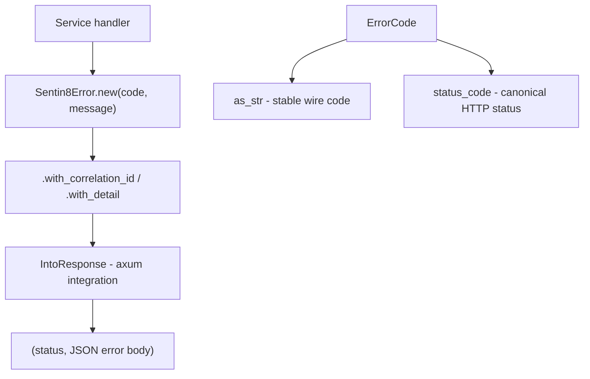

# Design Doc: sentin8-errors (Normalized Error Types & Codes)

## 1. Summary

`sentin8-errors` defines the platform-wide error surface: one canonical
error type (`Sentin8Error`), one stable machine-readable code registry
(`ErrorCode`), and one response shape used by every Sentin8 service. Every
service's HTTP error responses are produced by this crate's axum
integration, guaranteeing a uniform problem-details contract across the
platform.

## 2. Motivation

- **One error contract.** Without a shared crate, each service would invent
  its own error JSON shape, code vocabulary, and status mapping, forcing
  every client (BFF, Dash, SDKs) to special-case each service.
- **Stable wire codes.** Error codes are part of the API contract: clients
  branch on `sentin8_auth_token_expired` or `not_found` rather than parsing
  human messages. Codes must therefore be stable across releases.
- **Correlation everywhere.** Every error can carry a correlation ID so a
  request can be traced across services through logs and audit trails.

## 3. Architecture & High-Level Design



The response body shape (canonical problem-details for the platform):

```json
{
  "error": "<error_code>",
  "message": "<human-readable message>",
  "correlation_id": "<uuid>",
  "details": { }
}
```

`correlation_id` and `details` are omitted when empty - the minimal body is
always `{ error, message }`.

## 4. Key Traits and Data Structures

- **`ErrorCode`** - the closed registry of stable codes, grouped
  cross-cutting (`invalid_request`, `unauthorized`, `forbidden`,
  `not_found`, `conflict`, `rate_limited`, `upstream_error`,
  `tenant_resolution_failed`, `tenant_mismatch`, `feature_disabled`,
  `internal`) and per-service (`sentin8_auth_*`, `sentin8_tls_*`,
  `sentin8_bff_*`, `sentin8_db_*`, `sentin8_storage_*`, `sentin8_bus_*`,
  `sentin8_sys_*`, `sentin8_app_*`, `sentin8_func_*`, `sentin8_cron_*`,
  `sentin8_flow_*`, `sentin8_stat_*`). Serialization uses snake_case.
- **`Sentin8Error`** - the carrier: `code` + human `message` + optional
  `correlation_id` + structured `details` map. Implements
  `std::error::Error` (via thiserror) and axum `IntoResponse`.
- **`ErrorResponse`** - the serialized body shown above.
- **Convenience constructors** - `invalid_request`, `unauthorized`,
  `forbidden`, `not_found`, `conflict`, `internal` for the cross-cutting
  codes; full constructors via `Sentin8Error::new`.
- **`From<anyhow::Error>`** - converts unstructured internal failures into
  `internal` errors so `?` propagation from anyhow-heavy code paths keeps
  the response contract.

## 5. Rationale, Trade-offs, and Alternatives

- **Closed enum over open strings.** A closed `ErrorCode` enum gives
  compile-time exhaustiveness for status mapping and prevents typos in wire
  codes; the trade-off is that adding a code requires changing this crate.
  That is intentional: the code registry is a platform contract, not
  something services extend casually (vertical-specific codes are
  runtime-registered in the platform registry, not here).
- **Code → status centralized here.** Each service maps its domain failures
  to codes; this crate owns the code→HTTP-status table. Mapping status at
  the construction site would fragment the contract and invite drifted
  status choices for the same code.
- **`BTreeMap` for details** - deterministic serialization order so the
  same error produces byte-identical responses (stable logs, cacheable
  fixtures in tests).
- **Carrying correlation as an option, not a required field.** Errors
  raised before a correlation ID exists (e.g. middleware failures) remain
  constructible; the middleware injects the ID when available.
- **Rejected: RFC 7807 `application/problem+json` media type.** The
  platform standardized on the simpler `{error, message, correlation_id,
  details}` JSON shape under `application/json`; switching media types would
  break every existing client for no functional gain.

## 6. Internal Implementation & Invariants (Private Design)

- **Code string stability.** `as_str` returns `&'static str` literals; wire
  strings must never change once released. Cross-cutting codes use bare
  names (`not_found`); service codes are prefixed
  `sentin8_{service}_{problem}`.
- **Status mapping invariants.** Tenant-mismatch family → `400`
  (client supplied a wrong tenant, not a server fault);
  tenant-resolution-failure and unknown-hostname → `421 Misdirected
  Request` (edge context problem); RLS violation and path traversal →
  `403` (security-relevant, must not leak as 404); feature-disabled →
  `501`.
- **`IntoResponse` never panics.** Body construction is infallible
  (string + JSON serialization of owned data).
- **The `details` map is for non-sensitive context only** - identifiers,
  resource kinds, counts. Secrets, tokens, and credentials never belong in
  error details (they are logged and returned to clients).

## 7. Unresolved Questions / Future Designs

- i18n of `message` strings is a non-goal: messages are developer-facing and
  the platform is English-only.
- A machine-readable code catalog can be derived mechanically when needed (a
  `code_catalog()` function exposing code + HTTP status + retryability).

---

**Architecture & Design:** sentin8:errors and its underlying concepts were designed by [Hamid Jahanzad](https://www.linkedin.com/in/hamidjahanzad/).
