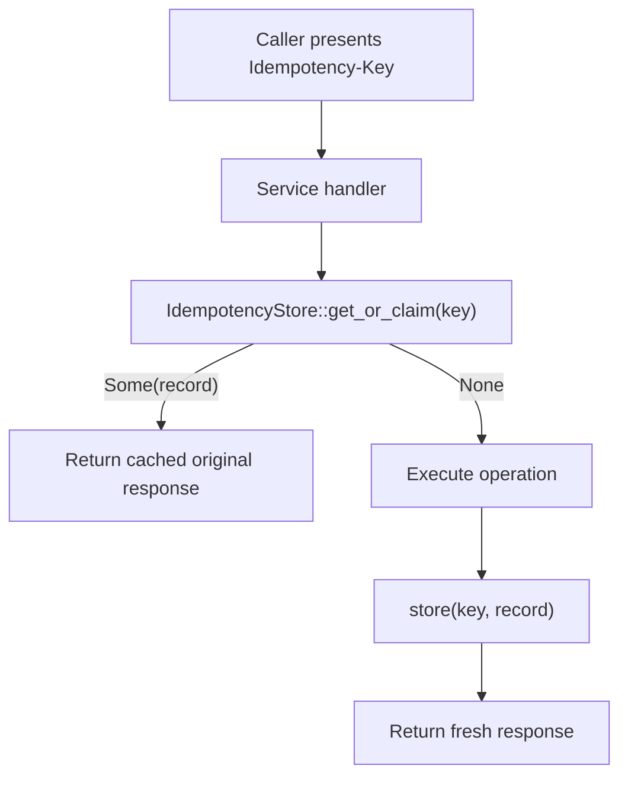

# Design Doc: sentin8-idempotency (Idempotency-Key Store Contract)

## 1. Summary

`sentin8-idempotency` defines the platform's idempotency contract: the
`Idempotency-Key` header convention, the `IdempotencyRecord` payload, and
the `IdempotencyStore` trait that services implement to make state-changing
operations replay-safe. A no-op store implementation ships with the crate.

## 2. Motivation

- **At-least-once delivery is the norm.** Clients retry on timeouts, event
  triggers retry with backoff, and network retries happen invisibly. A
  payment executed twice is not a retry problem - it is a money problem.
- **One contract, many backends.** Different services have different
  durability needs (Valkey TTL cache vs. PostgreSQL dedupe table). A single
  trait keeps handler-level wiring identical across services while letting
  each service pick its store.

## 3. Architecture & High-Level Design

The flow contract: claim first, execute only on a new key, store the result
under the key. Every trigger-based consumer dedupes on the event's
`idempotency_key` the same way.

## 4. Key Traits and Data Structures

- **`IDEMPOTENCY_KEY_HEADER`** - the canonical header name
  (`Idempotency-Key`).
- **`IdempotencyRecord`** - what gets stored: the key as presented, the
  original HTTP status code, and the serialized response body.
- **`IdempotencyStore`** - the async contract: `get_or_claim(key)` returns
  the cached record for a seen key or `None` for a new one (claiming it),
  and `store(key, record)` persists the result.
- **`NoopIdempotencyStore`** - every key is new; nothing is persisted.
- **`StoreError`** - backend failure surface.

## 5. Rationale, Trade-offs, and Alternatives

- **Trait object over concrete store.** Services wire the store behind the
  trait so handler code never branches on storage choice; tests can swap in
  a fake. The trade-off (dynamic dispatch on the claim path) is negligible
  next to the store round trip itself.
- **Claim-then-store (two calls) over a single callback.** A
  `with_idempotency(key, || result)` wrapper would need to know the HTTP
  response shape; the two-call contract keeps the crate HTTP-agnostic and
  lets each service own its response serialization.
- **`get_or_claim` naming.** The claim must be atomic in real backends
  (first writer wins); the contract documents intent so implementers know
  concurrent duplicates of the same key must resolve to exactly one
  execution.
- **No-op store ships with the crate.** Services without durable
  idempotency still compile against the same trait, so adopting a real
  store later is a wiring change, not a refactor.
- **Rejected: embedding TTL/retry policy in the trait.** Expiry is a
  backend property (Valkey TTL, table retention); baking it into the trait
  would force every store into one policy.

## 6. Internal Implementation & Invariants (Private Design)

- **Invariants:**
  - `NoopIdempotencyStore` never returns a record and never errors.
  - A stored record must be byte-equivalent to the original response
    (status + body) - replayed responses are indistinguishable from fresh
    ones.
  - The key is stored exactly as presented (no normalization) - callers
    own key semantics.
- **Concurrency contract.** Real backends must make `get_or_claim`
  atomic per key; two concurrent claims of one key must yield exactly one
  `None` (the executor) and one `Some` (the replayer).
- **Scope.** The crate intentionally does not implement middleware, TTL
  bookkeeping, or storage; those live with each adopting service.

## 7. Unresolved Questions / Future Designs

- A shared Valkey-backed store (TTL + response-body cache) is agreed -
  implement it when a consumer needs the shared store.
- Key scoping is defined preemptively in the trait docs: keys MUST be
  `{service}/{route}/{client-key}` namespaced.

---

**Design attribution:** sentin8:idempotency and its underlying concepts were designed by Hamid Jahanzad <Hamid@Jahanzad.com>.
