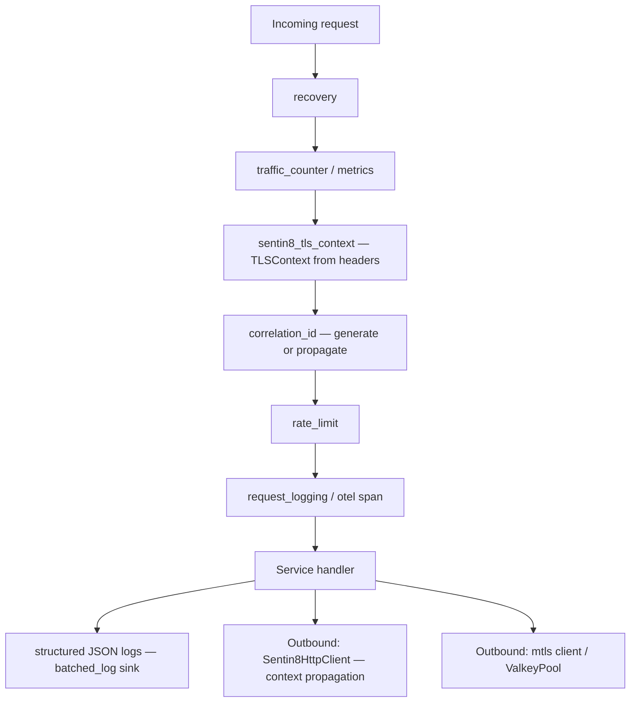

# Design Doc: sentin8-middleware (Shared Service Middleware Library)

## 1. Summary

`sentin8-middleware` is the shared axum/HTTP middleware library every
Sentin8 service links: correlation-id propagation, TLS-context extraction,
request logging, panic recovery, rate limiting, CORS/CSP, mTLS clients,
structured JSON logging, OpenTelemetry tracing, Prometheus-style metrics,
health endpoints, batching log sinks, and Valkey/HTTP client helpers. It is
the horizontal layer that makes cross-cutting behavior uniform across the
fleet.

## 2. Motivation

- **Uniform request context.** Every request must carry a correlation ID
  end-to-end and a tenant context extracted from TLS-injected headers —
  per-service implementations would drift and break log/audit correlation.
- **One observability stack.** Structured logs, metrics, and traces must be
  identical in shape across ~20 services so aggregation tooling works once.
- **Safe defaults.** Recovery, rate limiting, CORS, and CSP are
  security/correctness surfaces; centralizing them prevents a service from
  shipping without them or with divergent semantics.

## 3. Architecture & High-Level Design

Module map:

- **`context` / `logging` / `recovery`** — the request-scoped core:
  `TLSContext` extraction, correlation id (thread-local + header),
  request logging, panic → 500.
- **`http_client`** — `Sentin8HttpClient` with thread-local correlation-id
  propagation to outbound calls, plus a streaming variant without a total
  request timeout.
- **`rate_limit` / `cors` / `csp` / `mtls`** — edge policy middleware and
  client builders.
- **`structured_logging` / `batched_log`** — JSON event pipeline with
  batching sinks (written/dropped counters).
- **`otel_tracing` / `metrics` / `error_metrics`** — tracing and metric
  emission layers.
- **`health` / `shutdown` / `valkey_pool` / `traffic_counter`** —
  operational helpers shared by every service shell. The traffic counter
  also carries the in-flight request gauge (`RequestCounter::enter()` +
  RAII `InFlightGuard`) exposed as `active_connections` in the health
  payload — the drain signal captain polls during rolling upgrades.

## 4. Key Traits and Data Structures

- **`TLSContext`** — tenant context parsed from `X-Sentin8-*` headers:
  `env_id`, `application_id`, `service`, `hostname`, `domain_type`,
  `client_cert_thumbprint`. `env_id` is `None` for system-scoped requests.
- **`JwksVerifier` + `VerifiedClaims`** — the token-verification seam:
  claims (sub/iss/aud/exp/iat/jti/token_tp/env_id/scope) the authorization
  pipeline consumes; the current implementation is a stub returning an
  error, with services using the auth client SDK for real verification.
- **`Sentin8HttpClient`** — reqwest wrapper that attaches the current
  thread's correlation/tenant context to outbound calls (`current_context`,
  `set_thread_correlation_id`, `attach_context_to`).
- **`LogSink`** — the batching sink contract (`push`/`push_ref`, with
  `written`/`dropped` counters); `BatchedLogWriter` is the buffered
  implementation.
- **`RequestCounter`** — the in-process request counter feeding the metrics
  flush loop, plus the in-flight gauge (`enter()` → `InFlightGuard`,
  decrement-on-drop) surfaced as `active_connections` in the shell health
  payload (the drain contract captain polls during rolling upgrades).
- **`ValkeyPool`** — cheap-clone wrapper over a reconnecting multiplexed
  connection.

## 5. Rationale, Trade-offs, and Alternatives

- **Thread-local correlation context.** Outbound HTTP calls need the
  inbound correlation id; a task-local/`thread_local!` cell avoids
  threading the context through every function signature. The trade-off
  (manual propagation into spawned workers) is documented in
  `set_thread_correlation_id`.
- **Headers as the tenant-context transport.** The TLS layer strips and
  injects `X-Sentin8-*` headers; middleware extracts them into `TLSContext`
  once per request. Services never parse hostnames themselves — one trust
  boundary, one parser.
- **Stub JWKS verifier in the crate.** Real verification lives in the
  auth client SDK (JWKS caching is non-trivial and belongs beside Auth);
  the middleware keeps the claim shape so the authorization pipeline is
  typed regardless of the verifier implementation.
- **In-memory token-bucket rate limiting.** Per-process limiting with no
  shared state — cheap and dependency-free; multi-node deployments need a
  shared-store limiter, which is a future extension (the module documents
  the seam).
- **Batched log writing.** Synchronous per-event file/network writes would
  stall handlers; batching amortizes I/O. `push_ref` avoids a `to_string()`
  per event on the hot path, and dropped-line counters make log loss
  observable instead of silent.
- **Separate streaming HTTP client.** SSE consume must not be aborted by a
  total-request timeout, so `new_streaming()` builds a client without one —
  keeping the default client's timeout for ordinary calls.

## 6. Internal Implementation & Invariants (Private Design)

- **Invariants:**
  - `correlation_id` middleware generates a UUID when the incoming request
    has none and echoes the existing one otherwise — exactly one
    correlation id per request.
  - `TLSContext::from_headers` reads only the stripped-and-reinjected
    header set; client-supplied copies were removed by the TLS layer.
  - Recovery converts panics into a canonical 500 JSON body and never
    unwinds past the task boundary.
  - Rate limiter buckets are per `client_id` with steady refill; a request
    that would drain below zero is rejected.
  - `BatchedLogWriter` flushes on size/time thresholds and reports dropped
    lines through `LogSink::dropped`.
- **Shutdown.** `shutdown_signal` unifies graceful-stop signal handling so
  every service terminates listeners the same way.
- **Header name constants are `HeaderName` (lowercased, static)** —
  parsing once, not per request.

## 7. Unresolved Questions / Future Designs

- `JwksVerifier` is an interface stub; wire it to the auth client SDK's
  verifier after surveying callers (every service uses the SDK verifier via
  the shell pipeline today).
- Shared cross-node rate limiting is implemented when a consumer exists: a
  Valkey token bucket behind the existing seam.
- OpenTelemetry exporter configuration stays env-driven; richer sampling
  (per-route rules) is a non-goal.

---

**Design attribution:** sentin8:middleware and its underlying concepts were designed by Hamid Jahanzad <Hamid@Jahanzad.com>.
