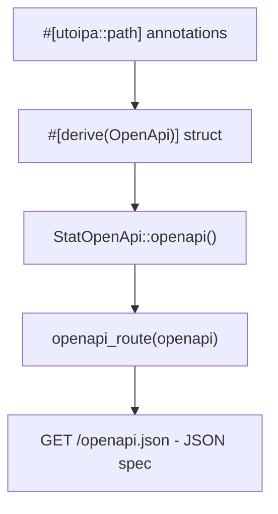

# Design Doc: sentin8-openapi (Shared OpenAPI Spec Generation)

## 1. Summary

`sentin8-openapi` centralizes OpenAPI spec generation for Sentin8 services.
Services annotate their axum handlers with `#[utoipa::path]` and derive
`OpenApi`; this crate re-exports the derive macro and provides the
`openapi_route()` helper that serves the generated spec at `GET
/openapi.json`.

## 2. Motivation

- **One spec convention.** Every service exposes a machine-readable API
  description at the same path with the same generation mechanism, so
  clients, the admin UI, and external integrations can consume any
  service's API the same way.
- **Specs cannot drift from code.** The spec is derived from the handler
  annotations at build time rather than maintained by hand.

## 3. Architecture & High-Level Design

## 4. Key Traits and Data Structures

- **`OpenApi`** - re-export of utoipa's derive macro; services declare a
  unit struct annotated with paths, schemas, tags, and security
  requirements.
- **`openapi_route(openapi)`** - mounts `GET /openapi.json` on an axum
  router, serving a build-time-generated spec.

## 5. Rationale, Trade-offs, and Alternatives

- **Thin re-export crate over direct utoipa deps everywhere.** Version
  pinning and any future spec post-processing (e.g. injecting the
  platform's security schemes uniformly) happen in one place; services stay
  on the same generator version.
- **Compile-time generation over runtime reflection.** utoipa generates
  the spec during compilation - no startup cost, no drift. The trade-off
  is that every handler change recompiles the service, which is already
  the norm.
- **One route per service (`/openapi.json`).** Uniform path across the
  fleet so tooling can discover specs without per-service configuration.

## 6. Internal Implementation & Invariants (Private Design)

- **Invariants:**
  - The route serves the exact `OpenApi` value passed in - no mutation or
    filtering.
  - The route path is always `/openapi.json`.
- **No runtime state.** The spec is a constant; the route closure moves it
  in and serializes per request.

## 7. Unresolved Questions / Future Designs

- A shared security-scheme injection (`with_bearer_security(spec)` helper
  injecting the standard `bearerAuth` scheme) is an easy add when a second
  consumer appears.
- Spec serving stays on the service's own port (the spec is a
  development/admin surface, not a client contract).

---

**Architecture & Design:** sentin8:openapi and its underlying concepts were designed by [Hamid Jahanzad](https://www.linkedin.com/in/hamidjahanzad/).
