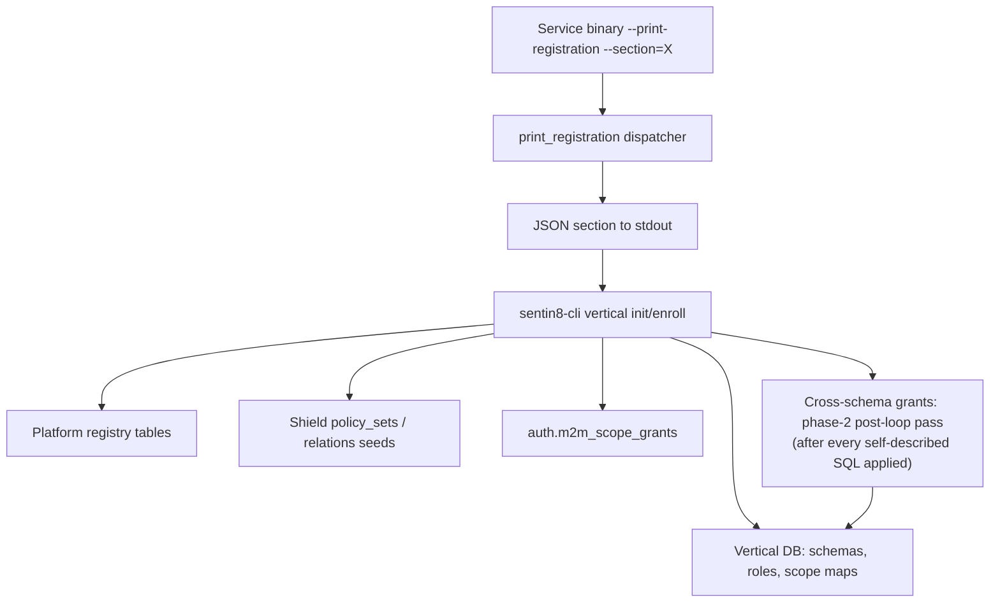

# Design Doc: sentin8-registration (Service Self-Registration Contract)

## 1. Summary

`sentin8-registration` defines the self-registration contract every
Sentin8 service fulfills: a `--print-registration` flag that emits the
service's full declarative identity (service info, admin scopes, error
codes, admin UI, SQL migrations, PostgreSQL OAuth role mappings, Shield
policy sets, ReBAC relations, event triggers, M2M grants, OpenAPI spec) as
JSON sections. This crate is the single definition of those structs and the
section dispatcher; services only supply data.

## 2. Motivation

- **Zero hardcoded platform knowledge.** The CLI and the platform must not
  embed per-service facts (domains, scopes, policies, tables). Each service
  self-describes; `sentin8-cli vertical init/enroll` consumes the output
  and provisions everything. Adding a service never requires changing the
  platform.
- **One shape, many consumers.** Enrollment (CLI), catalog registration,
  and admin-UI sidebar generation all read the same JSON sections.
- **Section-level access.** Consumers can request one section (`pg_roles`,
  `policies`) without parsing the full object.

## 3. Architecture & High-Level Design

| `--section=` | Output |
|---|---|
| *(none)* / `all` | Full `Registration` object (+ `openapi_spec`) |
| `service` | `ServiceInfo` |
| `admin_scopes` | `AdminScope` array (tuple or typed style) |
| `error_codes` | `ErrorCode` array |
| `admin_ui` | `Option<AdminUi>` |
| `consent` | `Consent` |
| `sql` | `SqlMigration` array |
| `pg_roles` | `PgRole` array |
| `policies` | `PolicySetDecl` array |
| `relations` | `RelationDecl` array |
| `event_triggers` | `EventTriggerDecl` array |
| `audit_findings` | `AuditFinding` array |
| `service_actions` | `ServiceActionEntry` array |
| `m2m_grants` | `M2mGrant` array |
| `openapi` | OpenAPI spec (from the closure) |

## 4. Key Traits and Data Structures

- **`Registration`** - the full declaration. Static slices for compile-time
  constants; `sql_migrations` is owned (services build them at runtime);
  the `openapi` function serializes the utoipa spec lazily.
- **`PgRole` + `CrossSchemaGrant`** - PostgreSQL 18 OAuth scope→role
  mappings and explicitly declared cross-schema SELECT grants. Enrollment
  applies exactly what is declared - never blanket grants. `bypass_rls` is
  rejected when `true`: no role on the cluster may bypass RLS.  Grant **convergence semantics**: a declared grant may reference a table
  owned by a service that enrolls LATER in the registry (registry order is
  not dependency order - e.g. bff declares reads on `sys.environments`,
  sys owns the table and enrolls after bff). Enroll therefore applies
  cross-schema grants in a **post-loop pass** after every self-described
  SQL migration has been applied - grants are idempotent re-grants, so
  re-enroll converges on a fresh AND a drifted database alike. An inline
  per-service application would silently skip on a fresh boot
  (`undefined_table` - the grant-drift incident class).- **`PolicySetDecl`** - a default Shield policy set (`enforced` by default;
  `shadow` only for tenant authoring/rollback), validated by the CLI at
  enroll time.
- **`RelationDecl`** - a ReBAC relation tuple seeded into `policy_relations`.
- **`EventTriggerDecl`** - declarative event→work binding
  (`func` / `flow` / `cron` / `direct`), so triggers are data, not code.
- **`M2mGrant`** - DCR workload scope grants (the service's own identity,
  the `-policy` Shield-reload consumer, the stat emitter), upserted into
  `auth.m2m_scope_grants` so the fail-closed DCR gate admits registration.
- **`AdminUi` / `AdminUiPage`** - RFW admin-UI declarations consumed by the
  Dash renderer (Material Icons code points, POST-alias data endpoints).
- **`AdminScope`** - untagged enum preserving both output shapes: platform
  tuple pairs and vertical typed objects.

## 5. Rationale, Trade-offs, and Alternatives

- **Self-description over registry hand-editing.** Every service already
  knows its own domains/scopes/policies; asking the CLI to hardcode them
  would couple the platform to each service's lifecycle. The trade-off is
  that each service ships a registration module - a small, typed,
  versioned cost.
- **Static slices (`&'static [...]`) over builder API.** Registration data
  is compile-time constant per service; static slices make the contract
  trivially serializable and prevent runtime mutation.
- **Section dispatch in the shared helper.** Every service prints identical
  section names; centralizing dispatch prevents per-service spelling
  drift (`--section=pgroles` vs `pg_roles`) and keeps `openapi` lazy.
- **Untagged `AdminScope`.** Platform and vertical enroll flows already
  consume both shapes; untagged serde keeps backward-compatible output
  while supporting typed declarations.
- **`openapi` as a closure field.** The utoipa spec is expensive to build;
  serializing only for the `all`/`openapi` sections keeps per-section
  calls cheap. `serde(skip_serializing)` keeps the field out of the
  derived JSON (it is injected under `openapi_spec` for `all`).
- **Scope vocabulary enforced in declarations.** M2M grants must use the
  full prefixed scope form; the fail-closed DCR gate's superset check
  rejects unprefixed spellings, so the declaration is the fix point.

## 6. Internal Implementation & Invariants (Private Design)

- **Invariants:**
  - Section names are exactly the ones the dispatcher matches; an unknown
    section is an error (fail fast, not silent empty output).
  - `Registration.service_type` is the canonical colon identity; `subdomain`
    defaults to the service_type minus a `sentin8-` prefix when unset.
  - Empty policy/relation slices omit their JSON keys entirely (not `[]`)
    - absent means "none declared".
  - `PgRole.bypass_rls` must be `false`; enrollment rejects `true`.
  - Cross-schema grants are SELECT-only by vocabulary.
- **Versioning.** `SqlMigration.version` ordering is honored by enrollment;
  SQL is applied idempotently (CREATE IF NOT EXISTS style) so re-running
  `vertical init` is safe.
- **Output stability.** Section JSON shapes are wire contracts consumed by
  the CLI; the untagged enum and skip attributes exist to keep shapes
  stable across style evolution.

## 7. Unresolved Questions / Future Designs

- A JSON Schema for the registration output is a non-goal: it duplicates the
  typed structs - a `validate()` const-eval is the lighter seam.
- Per-section schema-version fields stay out: whole-object evolution is the
  greenfield contract (no consumers lag a version).
- `event_triggers` validation (target-shape checks per `kind`) can move into
  the `EventTrigger` type's `validate()` when enrollment needs it earlier.

---

**Design attribution:** sentin8:registration and its underlying concepts were designed by Hamid Jahanzad <Hamid@Jahanzad.com>.
