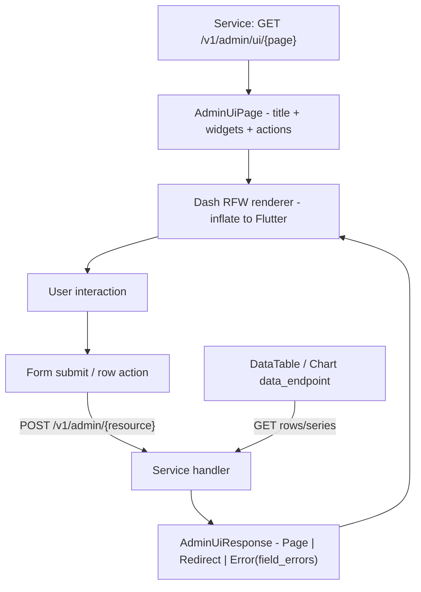

# Design Doc: sentin8-rfw (Remote Flutter Widget Admin UI Types)

## 1. Summary

`sentin8-rfw` defines the declarative Remote UI contract between backend
services and the Sentin8:Dash rendering host. Every service that provides
admin UI returns these widget-tree definitions from
`GET /v1/admin/ui/{page}`; the Dash Flutter runtime inflates them into
native widgets and proxies mutations back to the service's
`POST /v1/admin/{resource}` endpoints. The crate also ships the shared
Policy Studio page constructors every adopting service reuses.

## 2. Motivation

- **Dash must know nothing about services.** The admin UI host is a pure
  rendering engine with zero compile-time knowledge of verticals or
  platform services. If Dash embedded even one service's page, every new
  service would require a Dash release. RFW definitions turn admin UI into
  runtime data.
- **Backend-owned UX.** The service that owns the domain also owns its
  admin experience - forms, tables, and actions evolve with the service,
  not with the host.
- **One wire contract.** A typed, serde-tested widget vocabulary prevents
  every service from inventing its own page JSON that the renderer cannot
  draw.

## 3. Architecture & High-Level Design

- **Pages** - `AdminUiPage` (title, widget list, header actions) is the
  top-level response of the UI endpoint.
- **Widgets** - `RemoteWidget` is the tagged enum over the nine node kinds:
  container, text, data table, form, button, card, chart, native host, row,
  column, spacer.
- **Responses** - `AdminUiResponse` is the mutation envelope: render a page,
  redirect after success, or report errors with per-field validation
  messages.
- **Policy pages** - `policy_page()` builders generate the four shared
  Policy Studio pages (list, editor, relations, attributes) from a colon
  service identity; the pages are definitions only, and all data flows
  through the shared policy-admin API the service already mounts.

## 4. Key Traits and Data Structures

- **`RemoteWidget`** - the tree node enum (`serde(tag = "type")`); every
  variant is a plain serializable struct, so the renderer maps 1:1 to
  Flutter widget constructors.
- **`WidgetDataTable` / `WidgetDataTableColumn`** - server-side tables:
  columns (key, label, format), a data endpoint relative to
  `/v1/admin/`, optional row link and per-row action buttons supporting
  `{row.id}` substitution.
- **`WidgetForm` / `WidgetFormField`** - forms with 16 field types,
  validation constraints, conditional visibility (`visible_if`), and a
  submit endpoint relative to `/v1/admin/`.
- **`WidgetNative`** - the escape hatch: the dash renders a built-in
  Flutter widget (`posting_console`, `payment_simulator`,
  `workflow_visualizer`, …) with service-provided props.
- **`AdminPage`** - the builder used by services to assemble pages.
- **`AdminUiResponse::Error`** - carries `field_errors` keyed by form-field
  name so the renderer highlights the exact inputs.

## 5. Rationale, Trade-offs, and Alternatives

- **Custom widget enum over raw RFW (Google's Remote Flutter Widgets).**
  Google's RFW text-format and core widget set do not cover admin
  surfaces (data tables with row actions, typed forms, formatters like
  `iban`/`currency`). A platform-owned vocabulary is larger but maps
  1:1 to the renderer; raw RFW would need custom template expressions
  everywhere. The trade-off is renderer-side work per widget type - paid
  once in Dash, reused by every service.
- **Relative endpoints (`/accounts`) resolved under `/v1/admin/`.** Pages
  stay tenant- and service-agnostic; the renderer binds the absolute
  prefix per request. Hardcoded absolute URLs would leak service topology
  into definitions and break under proxying.
- **POST-only mutations.** The renderer supports POST for all admin
  mutations; services expose POST alias routes for update/delete instead
  of teaching the renderer every HTTP verb. Icons are Material Icons code
  points (hex strings), never names, so the wire stays rendering-engine
  independent.
- **Native widget escape hatch.** Complex, stateful admin surfaces
  (payment simulators, workflow visualizers) cannot be expressed as static
  trees; the native host lets a service inject a dash-provided rich widget
  with props while remaining zero-knowledge from Dash's perspective (it
  recognizes a fixed set of built-ins).
- **Definitions, not data, in pages.** `data_endpoint` indirection means
  the UI endpoint returns structure only; the renderer fetches rows
  separately. This keeps pages cacheable and lets tables refresh without
  re-rendering the page.
- **Server-side policy simulation.** The Policy Studio "test" action posts
  to the dry-run endpoint; the browser never evaluates policy - the
  fail-closed single decision point stays in Shield.
- **Rejected: embedding business logic in page definitions.** Definitions
  are display + routing only; validation beyond declarative constraints
  lives server-side, so a malicious client cannot weaken enforcement.

## 6. Internal Implementation & Invariants (Private Design)

- **Invariants:**
  - Row-action endpoints substitute ONLY `{id}` from the row's `id`
    field - row lists must therefore carry `id` = the canonical key
    (policy-set name, colon-joined tuple key, etc.).
  - Static pages have no row context: any value the renderer would need
    per entity (e.g. a policy-set name in an editor) must be embedded in
    the widget props at generation time, never as a `{placeholder}`.
  - Every `data_endpoint`/`submit_endpoint` is relative; the renderer
    joins it with the mounted `/v1/admin/` prefix of the owning service.
  - The response envelope is tagged by `response_type` with snake_case
    variants; consumers dispatch on it before touching payloads.
  - Field errors address fields by their `key` in the originating
    `WidgetForm`.
- **Optional-field convention.** Renderer-defaulted fields use
  `#[serde(default)]` (spacing, page size 0 = default, labels empty =
  hidden) so definitions stay minimal.
- **Polymorphic equality.** All types derive `PartialEq` so tests assert
  full page definitions structurally.

## 7. Unresolved Questions / Future Designs

- The native-host widget set stays a fixed registry for now: verticals extend
  UIs via the declarative widget set.
- The chart vocabulary is minimal; extend `SeriesType` when the first
  analytics page lands (stacking, series typing).
- Form field `KeyValue` and `File` types are declared but under-exercised;
  keep the types (the contract is stable) and close the lag by exercising
  them.

---

**Architecture & Design:** sentin8:rfw and its underlying concepts were designed by [Hamid Jahanzad](https://www.linkedin.com/in/hamidjahanzad/).
