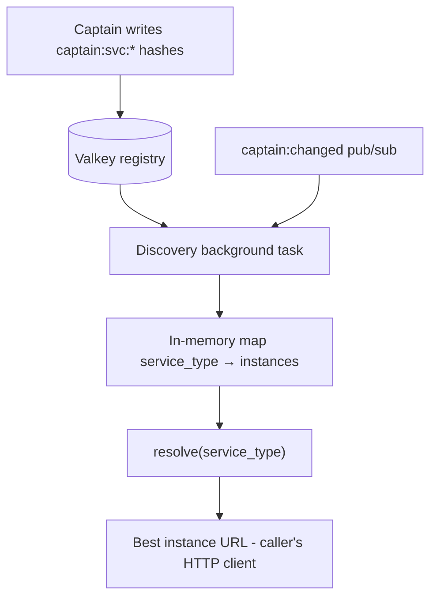

# Design Doc: sentin8-service-discovery (Registry-Backed Instance Resolution)

## 1. Summary

`sentin8-service-discovery` is a client library that resolves service
backends from the Captain's Valkey registry with automatic reconnection,
pub/sub-driven freshness, and load-aware instance selection. Services embed
it to find healthy peer instances (e.g. Sentin8:Acme for certificate
issuance) without hardcoding ports or IPs.

## 2. Motivation

- **No hardcoded backends.** Captain auto-assigns ports and replaces
  instances during rolling upgrades; any hardcoded `ip:port` in a caller
  breaks on the first upgrade. Discovery turns the captain registry into
  the single source of truth for callers.
- **Rolling-upgrade transparency.** When an instance's port changes or a
  new instance replaces an old one, callers pick it up on the next
  registry notification - no restart, no config change.
- **Load-aware routing.** With multiple instances of one service, calls
  should favor healthy, low-load, same-machine instances.

## 3. Architecture & High-Level Design

- The background task subscribes to the `captain:changed` pub/sub channel
  and rebuilds its in-memory map on every notification (debounced) plus a
  safety poll catching missed notifications.
- Only `Active` instances with a fresh health check (30 s window) are
  resolvable; `Active` instances not yet probed are given the benefit of
  the doubt (a just-started instance must not be invisible until its first
  probe).
- Callers get `https://{ip}:{port}` - every Sentin8 service terminates TLS
  directly, so the root CA must be in the OS trust store.

## 4. Key Traits and Data Structures

- **`ServiceDiscovery`** - clone-cheap shared handle. `spawn(valkey_url,
  local_ip)` starts the background task and returns immediately. `resolve`
  returns the best instance URL; `resolve_instance` the full record;
  `list` all known instances of a type; `service_types` the registry keys.
- **`ServiceInstance`** - the registry row as stored by the captain:
  identity (`key`, `service_type`, `local_ip`, `local_port`, `pid`),
  lifecycle (`status`, `start_priority`, `restarts`, `started_at`),
  liveness (`last_health_check`), and load signals (`cpu_avg_1m`,
  `memory_avg_1m`, `latency_avg_1m_ms`, `errors`, `warnings`).

## 5. Rationale, Trade-offs, and Alternatives

- **Push (pub/sub) + safety poll.** Pub/sub notifications give ~200 ms
  freshness after a registry change; a 60 s safety poll catches missed
  notifications (Valkey restarts evict pub/sub state). Either alone is
  insufficient: poll-only wastes 60 s of staleness, pub/sub-only freezes
  permanently on a lost stream.
- **In-memory snapshot, resolve from RAM.** Discovery is on the hot path
  of cross-service calls; a per-call registry round trip would add latency
  and load. The snapshot is rebuilt wholesale (KEYS + HGETALL) on refresh -
  simple, consistent, and bounded by the ~20-service registry size.
- **Load score `cpu*0.5 + mem*0.3 + latency/20*0.2`** (clamped to 0-100).
  Weighted toward CPU (the dominant saturation signal), with memory and
  latency as secondary signals. Latency is normalized (2000 ms → 100) so a
  slow-but-idle instance cannot win.
- **Local-machine bonus (20 points) applied at selection, not scoring.**
  Loopback is faster than cross-subnet, but a saturated local instance
  (selection 80) must lose to an idle remote (50). Keeping the bonus out of
  `load_score` preserves a pure, comparable load metric.
- **Separate pub/sub client per reconnect.** A pub/sub connection is a
  blocking-mode connection and cannot share a client with the multiplexed
  command connection without interference; each reconnect builds a fresh
  subscription.
- **Reconnect-on-stream-end, never break the loop.** If the pub/sub stream
  ends (Valkey restart, network blip), the loop rebuilds the subscription.
  Without this, the map freezes, the 30 s freshness check fails for every
  service, and resolution returns `None` platform-wide.
- **Rejected: per-service HTTP health-check from the discovery client.**
  The captain already probes health and writes freshness; duplicating
  probes doubles load and can disagree with the registry.

## 6. Internal Implementation & Invariants (Private Design)

- **Invariants:**
  - `resolve`/`resolve_instance` consider only `is_healthy()` instances
    (`Active` + health check within 30 s, or never probed).
  - Selection = lowest `selection_score(my_ip)`; ties broken deterministically
    by the map order after the sort.
  - The in-memory map is replaced wholesale on refresh - never patched -
    so stale instances disappear in one atomic swap.
  - The background task never returns early: a failed pub/sub connect or
    subscribe degrades to safety-poll-only refresh.
- **Debounce.** A 200 ms sleep after a notification coalesces bursts of
  registry writes (e.g. a mass upgrade) into one scan.
- **`KEYS` usage.** The scan uses `KEYS captain:svc:*` - acceptable at this
  registry scale; would need `SCAN` if the registry ever grew large.
- **Graceful degradation.** Every failure path in the loop logs a WARN and
  continues with a safety sleep; discovery never panics the host task.

## 7. Unresolved Questions / Future Designs

- `resolve` stays stateless by contract: affinity belongs to the caller with
  the affinity requirement.
- The 20-point local bonus and load weights are constants; when tuning is
  motivated, read them from `SENTIN8_DISCOVERY_*` config keys.
- Registry keys use a `KEYS` glob scan; switch to `SCAN` (`MATCH captain:*
  COUNT 100` cursor loop) - the refresh path is the only caller.

---

**Architecture & Design:** sentin8:service-discovery and its underlying concepts were designed by [Hamid Jahanzad](https://www.linkedin.com/in/hamidjahanzad/).
