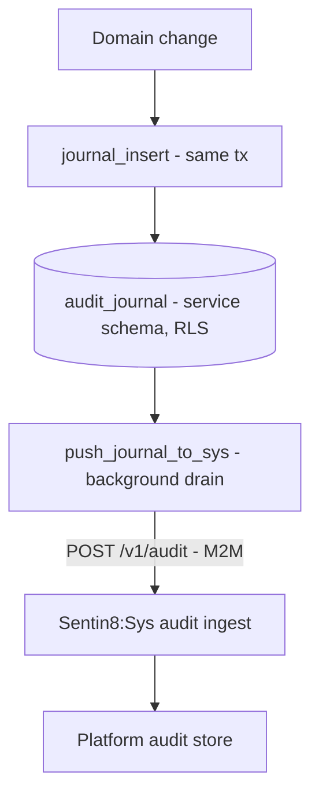

# Design Doc: sentin8-audit (Audit Event Envelope & Journal Pipeline)

## 1. Summary

`sentin8-audit` defines the platform's audit surface: the canonical
`AuditEvent` envelope, the emitter contract, and the journal-first pipeline
that guarantees audit durability. Every state-changing operation writes a
journal row in the service's own schema within the domain transaction and a
background task drains the journal to the Sys audit ingest API.

## 2. Motivation

- **Audit is not optional and never lost.** A Sys outage must not drop
  audit events; a local spill journal makes the platform's audit trail
  independent of any single service's availability.
- **Uniform attribution.** Every event carries who (actor + type), what
  (action + resource), where (tenant scope), why-when (message, severity,
  correlation id), and state transitions (before/after) - the same shape
  from every service so Sys and downstream tools query one schema.
- **Transaction-bound truth.** The journal row commits with the domain
  change, so an operation and its audit record exist or don't exist
  together.

## 3. Architecture & High-Level Design

- The service keeps `{service}.audit_journal` (DDL shipped by
  `audit_journal_sql`), RLS-protected, with a `pushed` flag.
- `journal_insert` writes the row on the same connection/transaction as
  the domain change.
- `push_journal_to_sys` batches unpushed rows to `POST /v1/audit` (M2M,
  `sentin8:sys:audit:write`) and marks them pushed; failures leave rows
  unpushed for the next pass - a Sys outage never drops audit. The HTTP
  client is built once per process (pooled PQ-TLS session to Sys - a
  per-pass client would pay a fresh handshake on every push).
- Sys stamps the authoritative `service` from the verified M2M `client_id`;
  the envelope's `service` field is advisory.

## 4. Key Traits and Data Structures

- **`AuditEvent`** - the canonical envelope: identity (`id`), emitter
  (`service`), action + resource (`AuditAction`, type, id), actor
  (`actor_id`, `actor_type`: system_user / org_staff / customer / machine /
  api_client / support_actor), tenant (`org_id` context-only, `env_id`),
  optional `application_id`, `severity`, timestamp, `correlation_id`,
  `message`, structured `details`, and before/after state snapshots.
- **`AuditEventBuilder`** - the constructor surface; `id`/timestamp are
  generated, severity defaults to `Info`.
- **`AuditEmitter`** - async sink trait (`emit`); `NoopAuditEmitter` ships
  for tests/services without audit yet.
- **`AuditSeverity`** - `info` / `warning` / `error` / `critical`.
- **`AuditAction`** - create / update / delete / archive / login / logout /
  grant / revoke / execute / other.
- **`SecurityAuditResult` + `AuditCategory`** (security_audit module) -
  checklist findings for the three security pillars: token validation edge
  cases, RLS coverage, and secret-reference enforcement.

## 5. Rationale, Trade-offs, and Alternatives

- **Journal-first over direct produce.** Writing audit in the domain
  transaction guarantees no event is lost to a crash between domain commit
  and emission; the journal drain is retried indefinitely. The alternative
  (emit-to-Bus in-request) couples audit durability to Bus availability.
- **RLS on the journal.** The journal is tenant data (`env_id`); it sits in
  the service's schema under the same tenant-context rules as domain
  tables, so a mis-scoped read cannot sweep audit rows across tenants.
- **Envelope over free-form JSON.** A typed envelope gives Sys a stable
  ingest schema and makes correlation/retention queries indexable; `details`
  remains a JSON escape hatch.
- **before/after snapshots.** Updates and deletes are auditable only with
  state; storing compact snapshots (not full-row dumps) keeps the journal
  bounded.
- **Checklist-style security audit module.** The security pillars are
  encoded as data (category/severity/finding/recommendation) so they can be
  surfaced in UIs and CLI output without bespoke code per pillar.

## 6. Internal Implementation & Invariants (Private Design)

- **Invariants:**
  - `journal_insert` uses the caller's executor - it never opens its own
    transaction; callers keep the domain-transaction pairing.
  - Journal rows are only marked `pushed` after a 2xx from Sys; the mark
    runs in its own transaction (per-id updates), so a crash mid-mark
    re-pushes harmlessly (Sys dedupes by event id).
  - `push_journal_to_sys` caps each pass at 200 rows (bounded memory,
    bounded latency).
  - `org_id` is context-only (resolved from `env_id`); `env_id` is the
    tenant key.
  - The event `id` is the dedupe key - exactly-once at Sys.
- **Actor/subject typing.** `actor_subject_type` is a string enum on the
  wire; adding a new actor type is additive.
- **Serialization stability.** `AuditEvent` serde derives are part of the
  Sys ingest contract; optional fields are omitted when absent (never
  serialized as null) - consumers must treat missing as absent.

## 7. Unresolved Questions / Future Designs

- Retention/archival policy for `audit_journal` (pruning pushed rows) is a
  shared push-loop concern: the same task that drains pushed rows can delete
  them on a retention schedule.
- A streaming emitter (Sys SSE) is not needed by this crate: consumers of
  real-time audit events subscribe to the Sys event stream directly; the
  journal stays the durability layer.
- The security-audit checklist is a non-goal for the crate: it stays a curated
  registry; live checking is an admin-surface concern.

---

**Architecture & Design:** sentin8:audit and its underlying concepts were designed by [Hamid Jahanzad](https://www.linkedin.com/in/hamidjahanzad/).
