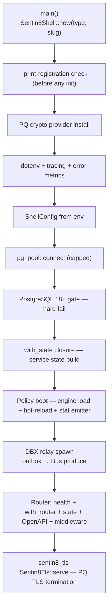

# Design Doc: sentin8-shell (Canonical Service Boot & Shared State)

## 1. Summary

`sentin8-shell` is the canonical boot sequence and shared runtime state for
every Rust service on the platform — platform services and all verticals.
It owns the normative startup order (self-registration → PQ crypto →
config → capped DB pool → PostgreSQL gate → state → router → in-process
PQ-TLS), exposes the service state (`ServiceCore`), boots the Shield policy
engine and hot-reload task for every service, and provides the shared
handler helpers (`set_tenant_context`, `verify_token`, `require_any_scope`,
error constructors) so all services follow the same authorization pipeline.

## 2. Motivation

- **One boot contract.** ~20 services must start in a deterministic order
  with identical security steps (crypto provider before any TLS, PostgreSQL
  18 gate, capped pools). Per-service `main` functions would drift and
  silently skip steps.
- **Uniform service surface.** Health endpoint shape, OpenAPI route,
  middleware stack, and policy-admin mount should not vary per service —
  the shell is the only place that assembles them.
- **Two state conventions, one API.** Platform services use value state
  (`State<AppState>`); services built on the shell use `Arc` state. The
  shell must support both without a fork in the boot path.

## 3. Architecture & High-Level Design

- **Registration-first.** `--print-registration` / `--section=` is checked
  before any initialization — no DB, no network, no crypto provider on that
  path (the self-registration contract).
- **`ShellConfig`** — per-service env config: port (hard fail if missing —
  captain injects `{SERVICE}_PORT`), database URL chain, Auth issuer, Bus
  URL, the shared Auth client (one instance so discovery/JWKS caches are
  reused), and the Valkey URL.
- **`ServiceCore`** — the common state (config + capped pool + the shared
  policy-admin surface); value-state services embed it, Arc-state services
  use it directly.
- **Boot steps 1–7 and 10 are not overridable** — the security and
  lifecycle contract; services extend through `with_state`, `with_router`,
  and `with_openapi`.

## 4. Key Traits and Data Structures

- **`Sentin8Shell`** — the builder: identity + registration printer +
  state closure + router extension + OpenAPI + flags (`own_layers`,
  `own_health`, metrics opt-out).
- **`ShellConfig`** — env-resolved configuration; `from_env` panics on a
  missing/invalid port (captain-owned, must exist).
- **`ServiceCore`** — config + pool + `SharedAdminState` (policy admin +
  engine), the shared state every service contains or uses directly.
- **`policy` module** — the step-5 gate for value-state services: `require`
  (full live evaluation → 403 on enforced deny); the shell's booted engine
  is the SAME instance admin writes go through.
- **`value_policy_admin_router`** — mounts the shared policy-admin routes
  for value-state services whose state is not `ServiceCore` (the
  `ValuePolicyAdmin` newtype satisfies the coherence constraint).
- **Request helpers** — `set_tenant_context` (RLS context on the caller's
  connection), `verify_token` (steps 1–4 only — never a scope check; step 5
  is Shield's), `require_any_scope` (platform-admin bypass via
  `sentin8:sys:admin`).

## 5. Rationale, Trade-offs, and Alternatives

- **Shell-owned policy boot.** If each service booted its own engine, two
  engine instances would fight over one DCR `{service}-policy`
  registration and the hot-reload consumer, risking a cache split between
  the request path and the admin API. The shell boots exactly one engine
  per process and exposes it via the core; services copy the Arc into
  their state.
- **Generic `with_state` over both conventions.** The closure's return
  type decides (Arc or value); there is no "legacy" parallel path to
  maintain, and platform handlers keep extracting their existing state
  struct unchanged.
- **Middleware as the standard stack.** Correlation, TLS context, request
  logging, traffic counter, and CORS are assembled by the shell in a fixed
  order; `own_layers` lets a service with a custom stack suppress it (used
  by integration tests), but production services take the default.
- **Port from env with hard fail.** Ports are captain-assigned; guessing a
  default would collide in the auto-assigned pool. Failing fast surfaces
  wiring mistakes at boot instead of at first request.
- **`AppState` type alias.** Keeps the value-state services' handler
  signatures (`State<AppState>`) compiling against `ServiceCore` without
  renaming every extractor.
- **Health owned by the shell by default.** A uniform liveness shape
  (`/v1/health` with service identity) lets the supervisor probe
  identically across the fleet; `with_own_health` opts a service out when
  its health payload carries domain data (OpenAPI-annotated). Shells with
  the metrics counter additively extend the standard body with
  `active_connections` (the in-flight request gauge captain drains
  against) — a metrics-disabled shell serves the plain four-key
  liveness shape. Custom bodies pick the same gauge up from the shell's
  process-wide registration (`traffic_counter::process_active_connections`),
  so every metrics-enabled service reports the drain signal.
- **DBX relay in step 8b.** Every shell service gets the outbox relay
  wiring once — publish-and-forget events become a one-line per-service
  concern instead of per-service async plumbing.
- **Rejected: per-service `main.rs` boot customization.** The observable
  boot contract (registration flag, PQ provider, PG gate, TLS mode) is
  platform security; making it overridable would reintroduce the exact
  drift the shell exists to prevent.

## 6. Internal Implementation & Invariants (Private Design)

- **Invariants:**
  - `--print-registration` never touches the network/DB/crypto provider —
    it must work on a bare binary.
  - The PQ crypto provider is installed before any HTTPS client is built.
  - `ShellConfig::from_env` fails the process on `{SERVICE}_PORT`
    missing/invalid; database URLs resolve through the documented chain.
  - `set_tenant_context` is awaited on the SAME connection the data query
    uses — the context is transaction-local; callers wrap context+queries
    in one transaction.
  - `verify_token` performs steps 1–4 only; adding a scope gate there would
    duplicate step 5 and is a review-blocking defect.
  - The policy engine instance inside `ServiceCore::admin` is the same
    instance `policy::require` evaluates — admin writes and request-time
    decisions share one cache.
  - `value_policy_admin_router` returns a state-BOUND router (the Arc
    parameter is the bind) because `with_router` runs before
    `Router::with_state`.
- **Metrics flush loop.** The request counter flushes to the shared
  publisher on a timer when `VALKEY_URL` is set; empty URL = quiet dev run.
- **OpenAPI merge.** The spec sits outside the middleware layers so the
  JSON is served untouched.

## 7. Unresolved Questions / Future Designs

- A shared graceful-drain window can be added as a `pre_shutdown` hook on the
  `ServiceRunner` (awaited before exit) when a service needs custom drain
  logic.
- The two state conventions converge on the newer convention during the next
  per-service doc pass (the registry reads both today); dual support is
  removed in the same change that migrates the last service.

---

**Design attribution:** sentin8:shell and its underlying concepts were designed by Hamid Jahanzad <Hamid@Jahanzad.com>.
