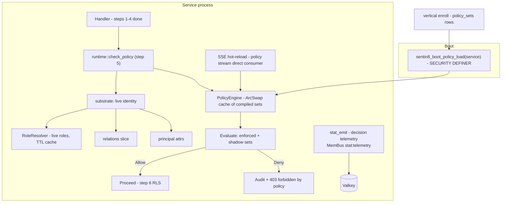

# Design Doc: sentin8-policy (Shield - Embedded Declarative Authorization)

## 1. Summary

`sentin8-policy` embeds the Shield declarative-policy engine in every
Sentin8 service as the platform's **authoritative authorization decision
point**. One engine decides all three models - RBAC (live-resolved role
membership), ABAC (attribute conditions), and ReBAC (relationship
hierarchy) - against policy *data* loaded from the service's own env-scoped
tables, with hot-reload over the event stream, fail-closed semantics, and
µs-scale in-process evaluation.

## 2. Motivation

- **One decision point.** Without an embedded engine, each service would
  hand-roll scope/role checks that drift from each other and cannot express
  attribute or relationship logic. A single declarative engine makes
  authorization reviewable as data and uniformly enforced.
- **Live authorization.** JWT-borne roles/scopes are stale the moment the
  token is issued. Role changes must take effect on the next request, so
  roles are resolved LIVE from Sentin8:Auth at evaluation time; the JWT
  scope claim is a coarse pre-filter and RLS feed only, never the decision.
- **Policies as data.** Platform sets ship through
  `vertical-registry.json` → `vertical enroll`; env admins author tenant
  sets at runtime. Zero compile-time vertical knowledge anywhere.
- **Fail closed, always.** A missing set, a broken policy, an eval error,
  or an unresolved role must deny - never fall open.

## 3. Architecture & High-Level Design

Components:

- **`PolicyEngine`** - the per-service engine: an `ArcSwap` cache
  `(env_id, set_name) → CompiledSet`, loaded at boot via the
  `sentin8_boot_policy_load` SECURITY DEFINER function (boot precedes any
  tenant context, so the RLS gate would otherwise hide all rows from the
  NOBYPASSRLS service role; the function filters `service = $1 AND enabled`
  server-side so a service can only load its own rows), plus upsert/remove
  for hot-reload and an atomic swap-on-success contract.
- **`runtime`** - the service-side integration: boot wiring
  (load-or-refuse-to-start), the step-5 evaluation entry points (snapshot
  evaluation and full live evaluation), the SSE direct-consumer hot-reload
  task, the sync-reload-on-empty-coverage retry (single-flighted), decision
  audit emission, the enroll-time dry-run gate, and identity-cache
  invalidation handling.
- **`substrate`** - the data plane: live role resolution (HTTP to
  Sentin8:Auth with a 30 s TTL cache per (env, subject)), relation-tuple
  and principal-attribute loaders, and identity types.
- **`admin`** - the shared policy-admin API (sets, relations, attributes
  CRUD + RFW POST aliases for the Dash renderer), enforce/shadow
  promotion, and server-side simulation.
- **`stat_emit`** - best-effort decision telemetry published to MemBus
  (`stat:telemetry` Pub/Sub family, consumed by Sentin8:Stat); fire-and-forget,
  log-only on failure, no service-scoped client (SDD §2.3). Frames carry
  `client_type = "server"` per stat's ingest contract.

## 4. Key Traits and Data Structures

- **`PolicyEngine`** - holds compiled sets behind `ArcSwap` (readers never
  block; swaps are atomic). Evaluation is pure, in-process, µs-scale, no
  I/O.
- **`RequestCtx`** - the evaluation input assembled from the verified
  token: subject, env/org, token type, effective scopes, the stale JWT
  scope snapshot (rides a separate `token_attrs` namespace so live scopes
  and the snapshot can never be confused), LIVE roles, the env relation
  slice, and handler-supplied principal attributes.
- **`EvalTarget`** - action id + optional resource uid/attributes.
- **`EvalOutcome`** - the enforce decision, the enforced-deny reason (audit
  input), and the shadow would-deny reason (telemetry input), plus the
  no-coverage predicate driving the sync-reload retry. Invariant: every
  path through the step-5 glue converts an enforced `Deny` into the 403
  error - including the post-reload re-evaluation, whose outcome falls
  through the same deny conversion as the boot-loaded path (a `Deny`
  outcome must never surface as `Ok`, or a no-coverage env bypasses
  authorization entirely).
- **`PolicySetRecord`** - a `policy_sets` row: owner service, name,
  description, Shield policy text (one statement per line), optional
  schema, `origin` (platform/tenant), `mode` (shadow/enforced), version,
  enabled.
- **`CompiledSet` / `CacheKey` / `Cache`** - the compiled-set cache types.
- **`RoleResolver`** - live role lookup with TTL cache; entries older
  than the TTL are pruned on insert so the per-`(env, subject)` cache is
  bounded; events (`sentin8:sys:identity:updated`, role/membership
  changes) sweep the cache so fresh access is visible immediately.
- **`PolicyError`** - parse/schema/validation/db/record/not-found failures.

## 5. Rationale, Trade-offs, and Alternatives

- **Embedded engine over a central authorization service.** A remote PDP
  would add a network hop to every request and a new availability
  dependency on the hot path. Embedding makes evaluation µs-scale and
  keeps decisions available during partial outages; the trade-off is
  per-service policy caches reconciled by events - accepted because
  policies are low-churn data and the sync-reload retry covers the
  propagation window.
- **ArcSwap over `RwLock`.** Readers (every request) take a cheap
  snapshot load; writers (boot, hot-reload) build a fresh map and store
  atomically. An `RwLock` would serialize reads behind reloads and admit
  writer starvation under load.
- **All-sets evaluation with enforced short-circuit.** Shadow sets must
  always contribute their would-deny signal, so evaluation cannot stop at
  the first deny; an enforced deny IS final and short-circuits. A
  single-set model could not express shadow parallel to enforced.
- **Fail-closed on no coverage.** "No matching permit → deny" extends to
  "no set at all for this env": a broken deploy (empty cache) must deny,
  not fall open. Every platform service seeds an enforced scope-mirror set
  at enroll, so the empty-cache case is a broken deploy by construction.
  The retry (single reload attempt under a lock) heals the freshly-created
  env case where the hot-reload event is still in the pipeline.
- **Live roles with TTL + event invalidation.** Purely TTL-based resolution
  bounded staleness at 30 s but produced stale-deny 403s immediately after
  role grants; the whole-env sweep on identity events makes grants
  effective on the next request while keeping the TTL as the backstop. A
  per-request Auth round trip was rejected: it multiplies Bus/Auth load
  with no correctness gain over the TTL+event combination.
- **Stale-token snapshot as a separate attribute namespace.** Platform
  policies may reference live `scopes`/`roles`; `token_attrs.scopes` exists
  so policies *could* observe the JWT snapshot, but no platform policy does
  - the namespace separation makes accidental downgrade of live scopes to
  token scopes structurally impossible.
- **Type canonicalization (PascalCase) for entity types.** Shield type
  names are case-sensitive while authoring uses conventional lowercase
  forms; canonicalizing at the engine boundary keeps authoring ergonomic
  without weakening matching.
- **Boot via SECURITY DEFINER loader.** The service's own NOBYPASSRLS role
  cannot read `policy_sets` before a tenant context exists; the loader
  function filters server-side by `service` (a service can only load its
  own rows) and keeps the admin API reading directly under request
  context. A blanket grant on the table was rejected (it would defeat RLS).
- **`shadow`→`enforced` promotion as a single UPDATE.** The mode column is
  the deployment lever - no separate rollout flag; shadow output
  (`policy.would_deny` telemetry) is the promotion evidence.
- **Rejected: JWT scope as the decision.** Scopes are pre-filters and RLS
  feed; making them the decision would freeze authorization at token-issue
  time and duplicate RBAC in every service.

## 6. Internal Implementation & Invariants (Private Design)

- **Invariants:**
  - Fail-closed everywhere: no matching permit → deny; eval/cache/
    role-resolution error → deny (+ audit); unparsable set at boot →
    refuse to start; no coverage for the env → deny; empty/invalid role
    set → role-gated rules deny.
  - M2M parity: token type never bypasses policy; `token_tp` is an
    attribute, not a bypass.
  - `load`/`load_from_rows` reject ANY invalid row and retain the previous
    cache (atomic swap) - a service never runs a partial policy set.
  - `upsert` of a disabled/invalid/not-ours set REMOVES the cached entry
    (no-match → deny), never leaves a stale set.
  - Boot load matches rows by the engine's own `service` value; a row from
    another service is an invalid record (error, not silently skipped).
  - The live scope set on a full evaluation is EMPTY on resolution
    failure - scope-gated rules then deny (fail-closed), never fall open.
  - Relation objects referenced by hierarchy edges are materialized as
    bare entities; a malformed uid skips the edge, which can only deny.
  - Principal attr eval failure falls back to a bare entity WITH hierarchy
    edges kept (edges are attribute-independent; dropping them would
    silently change decisions).
  - **Role-resolver cache is bounded.** The TTL is an eviction bound, not
    only a staleness check: an insert prunes entries older than the TTL
    before storing the new one. The cache otherwise grows with every
    unique `(env_id, subject_id)` that ever passed a policy gate for the
    life of the process (multi-tenant growth is unbounded without the
    sweep). The full-map clone per insert remains the write cost
    (a map-second variant could lower it); correctness is unchanged.
- **Statement splitting.** Policy text is split into statements at `;`
  boundaries respecting quotes/braces (so `contains("...;")` never
  terminates early), skipping `@annotation` comments; Shield parses one
  statement per string.
- **Write-time validation gate.** `validate_record_text` parses every
  statement and, with a schema present, runs strict schema-linked
  validation - invalid policy text is never stored, at enroll or via the
  admin API (size caps of 64 KiB text/schema return 413 before parsing).
- **Platform-row protection.** The admin API refuses to overwrite
  `origin='platform'` rows (409); enroll owns them. Tenant rows are
  env-admin-authenticated and schema-strict.
- **Audit + telemetry.** Enforced denies land in the shared audit trail;
  shadow denies emit `policy.would_deny` telemetry; emission failures
  degrade to log-only (never affect the decision).

## 7. Unresolved Questions / Future Designs

- The role-resolver TTL (30 s) balances freshness against Auth load; a push
  feed already exists (`sentin8:sys:identity:updated`), so the TTL is the
  polling fallback.
- Cross-service policy composition stays out: a set is validated against its
  own service's schema - per-service scoping is the invariant.
- Policy simulation across a whole env is a non-goal until an admin workflow
  needs it.
- Relation slices are capped per evaluation; the cap stays and is surfaced as
  a typed error (`RelationSliceExceeded`).

---

**Design attribution:** sentin8:shield and its underlying concepts were designed by Hamid Jahanzad <Hamid@Jahanzad.com>.
