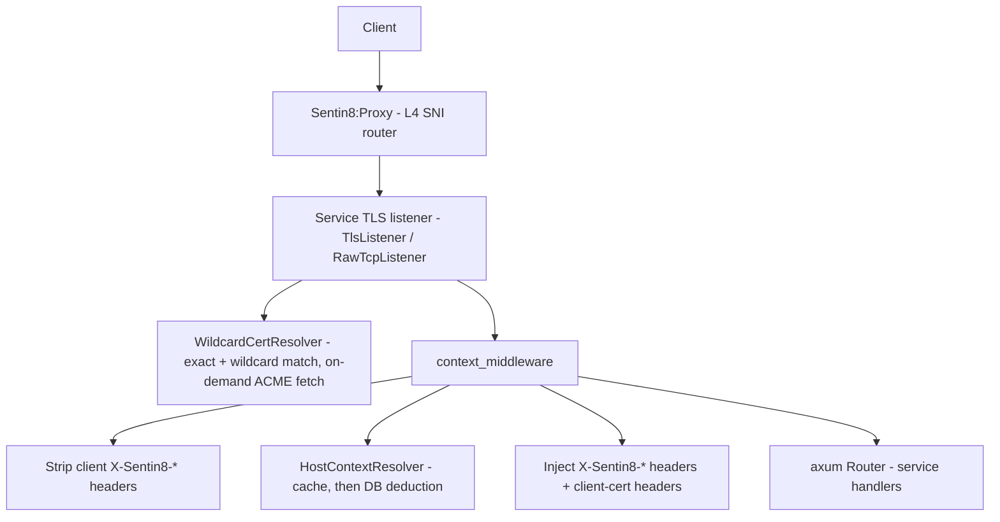

# Design Doc: sentin8-tls (Per-Service TLS Termination Library)

## 1. Summary

`sentin8-tls` is the platform library that every backend service links to
terminate post-quantum TLS **in-process**, resolve the request hostname to a
tenant/service context, and inject `X-Sentin8-*` context headers into every
request before it reaches a handler. It also provides the raw-TCP listener
used by non-HTTP protocols (SMTP, IMAP, POP3, ManageSieve, LMTP) for
STARTTLS and implicit-TLS operation.

## 2. Motivation

- **No central TLS-terminating proxy as a trust boundary.** Sentin8:Proxy is
  an L4 SNI router only; each service owns its own certificate and terminates
  TLS itself. Compromising the ingress does not yield plaintext traffic or a
  single pool of private keys.
- **Edge tenant context.** Every request must arrive at a handler already
  carrying `env_id`, `service`, and `app_id` context headers that the service
  did **not** have to resolve itself - and that a client cannot forge
  (client-supplied `X-Sentin8-*` headers are stripped first).
- **Post-quantum by default.** ML-KEM-768 key exchange with no classical
  fallback, per the platform TLS policy.
- **Zero-touch certificates.** Services must not ship static certs; certs are
  issued on demand from Sentin8:Acme at first handshake for a hostname.

## 3. Architecture & High-Level Design

Components:

- **`Sentin8Tls` (builder entry point).** One handle per service process.
  Built from `Sentin8TlsConfig`; owns the mapping cache, the cert resolver,
  and the host-context resolver. `serve()` blocks until shutdown; in
  `TlsMode::Off` it degrades to plain HTTP for local development.
- **`WildcardCertResolver`** - implements `rustls::ResolvesServerCert`.
  Serves exact-match and wildcard (`*.parent`) certificates from memory;
  on an unknown SNI it fetches the certificate from Sentin8:Acme
  synchronously (blocking the handshake, see §5) and caches it.
- **`HostContextResolver` + `MappingCache`** - hostname → `Mapping`
  resolution. The cache is an in-memory layer consulted first; the
  authoritative path is Sentin8:Sys's owner API
  (`GET /v1/resolve/hostname`, TLS-RLS-4) presented with the embedding
  service's cert-bound `{dash}-tls` M2M workload - the library holds NO
  SQL pool, so no service (platform or vertical) gains platform-database
  access by embedding it.
- **`context_middleware`** - axum layer performing the strip → resolve →
  inject pipeline (§6).
- **`TlsListener` / `RawTcpListener`** - TLS accept loops: axum-oriented
  (`serve`), optional-mTLS (`bind_with_client_auth`), and
  STARTTLS/implicit-TLS for non-HTTP protocols (`tcp.rs`).
- **Crypto provider** (`crypto.rs`) - rustls provider built on Graviola
  (pure-Rust, ML-KEM-768 capable), keyed off `SENTIN8_TLS_PQ_MODE`:

  | Mode         | Key exchange               | TLS versions | Use case                    |
  |--------------|----------------------------|--------------|-----------------------------|
  | `exclusive`  | X25519MLKEM768 only        | TLS 1.3      | **Default** - full PQ       |
  | `hybrid`     | X25519MLKEM768 + classical | TLS 1.3      | PQ-preferred, legacy clients|
  | `classical`  | X25519, P-256, P-384       | TLS 1.2+1.3  | Emergency rollback          |

## 4. Key Traits and Data Structures

- **`Sentin8Tls`** - the process-level handle. Exposes
  `tls_listener(addr)` (axum TLS, optional mTLS when
  `SENTIN8_TLS_CLIENT_CA_PEM` is set), `raw_tcp_listener(addr)`
  (STARTTLS/implicit TLS), `host_context_resolver()` (for wiring
  `context_middleware`), and `serve(addr, app, …)`.
- **`WildcardCertResolver: ResolvesServerCert`** - SNI-aware cert source with
  in-flight dedup (`pending`) and a failure backoff cache (`failed`).
- **`TlsStreamExt`** - extension trait over the accepted TLS stream exposing
  `peer_cert_der()`: the client leaf certificate from an optional-mTLS
  handshake, consumed for the client-cert context headers.
- **`HostContextResolver`** - cache-first, Sys-owner-API-fallback hostname
  resolver producing a `Mapping` (TLS-RLS-4: database-free).
- **`Mapping`** (in `tls-contracts`) - the resolved context: `hostname`,
  `service`, `org_id`, `env_id`, optional `application_id` +
  `backend_url` (app-instance hostnames; `backend_url` is developer-provided
  metadata stored with the app listing, never a hardcoded slug→URL map).
- **`PeerClientCert`** - request extension placed by the accept loop carrying
  the mTLS peer certificate DER into `context_middleware`.
- **`TlsInfo`** - negotiated protocol version, cipher suite, and peer chain
  for `Received:`-header fragments and DANE TLSA verification input.
- **`Sentin8TlsConfig` / `TlsMode`** - env-derived configuration
  (`SENTIN8_TLS_MODE`, `SENTIN8_TLS_CLIENT_CA_PEM`, `SENTIN8_DOMAIN`,
  `SENTIN8_ACME_DIRECTORY_URL` / `SENTIN8_ACME_PORT`,
  `SENTIN8_TLS_SERVICE_IDENTITY`).

## 5. Rationale, Trade-offs, and Alternatives

- **Synchronous on-demand ACME fetch (blocking the handshake).** Rejected
  alternatives: (a) pre-warming all certs at startup - services would fetch
  certs for hostnames they never serve and startup would depend on Acme
  being Active; (b) returning `None` on first use and fetching in the
  background - the first connection for every hostname would be reset, and
  clients retry only by accident. The synchronous fetch gives
  "first handshake succeeds, eventually": an unknown SNI blocks up to the
  fetch, and concurrent handshakes for the same hostname wait on the
  in-flight fetch instead of duplicating it.
- **Failure backoff (30 s) on ACME fetches.** Without a negative cache, an
  unreachable Acme turns every TLS handshake into a fresh ACME round trip -
  an unbounded retry amplification. Failures are cached per hostname and
  retried after the backoff window; entries older than the backoff are
  pruned on insert so the per-SNI negative cache stays bounded
  (the SNI key space is client-controlled and must never accumulate
  unpruned for the process lifetime).
- **Optional client auth with `allow_unauthenticated`.** Client
  certificate-binding (RFC 8705 `cnf`) must not break public clients
  (browsers, CLI sign-in). The listener *requests* a client cert and
  verifies it against the Acme Root CA when presented; anonymous handshakes
  are accepted and simply carry no peer-cert headers.
- **`PeerClientCert` as middleware state, not an `Extension` extractor.**
  The per-connection peer cert is captured once in the accept loop and
  promoted into request extensions by an infallible `State`-extractor
  middleware. An `Extension` extractor would 500 any nested router that
  predates the layer; `State` extraction cannot fail.
- **`connect_lazy` + pool cap 3.** The resolver needs at most one
  connection for deduction queries. An eagerly connected, default-sized pool
  across every service instance exhausts PostgreSQL connections and delays
  startup past the captain health-probe window. `connect_lazy` defers the
  connection until first use so the TLS listener binds immediately.
- **Domain-pattern deduction over a persisted hostname table.** Hostname →
  service mapping is derived from the uniform domain hierarchy
  (`{service}.{env}.{org}`, `bff.{app}.{env}.{org}`, …) with a suffix walk
  over registered org domains. A dedicated hostname table would be a second
  source of truth to keep consistent with org/env/app lifecycle events.
- **Cache consulted before deduction.** The `MappingCache` allows a service
  (or test) to pin explicit hostnames ahead of DB deduction; misses fall
  through to the authoritative DB path.

## 6. Internal Implementation & Invariants (Private Design)

- **Transaction-local tenant context.** `sentin8_set_tenant_context()` uses
  `set_config(..., true)` - the context evaporates at statement commit. The
  resolver opens ONE transaction, sets the SYSTEM tenant context on it, runs
  every deduction query on that same connection inside the transaction, then
  rolls back (read-only). Issuing any lookup on a pooled connection outside
  the transaction silently returns 0 rows under RLS.
- **Strip-before-inject trust model.** All `X-Sentin8-*` headers are stripped
  from client requests before any injection. The only legitimate source of
  client-cert headers is the `PeerClientCert` extension placed by the local
  TLS accept loop.
- **Health-endpoint bypass.** Captain health probes hit the service directly
  on `IP:port`, where the `Host` header is not a registered domain. Requests
  to `/health` / `/v1/health` skip host resolution (correlation ID only);
  without the bypass the middleware would 421 and the captain would kill
  healthy instances.
- **ACME endpoint resolution.** The Acme directory URL is resolved through
  service discovery (`sentin8:acme`); the HTTP client pins the discovered
  IP with `.resolve(sni_host, addr)` so the request carries the correct SNI
  - Acme's own TLS resolver can only find its bootstrap cert by hostname.
  No static fallback URL: if Acme is not yet Active, resolution fails fast.
- **Combined PEM split.** Acme's cert-download endpoint returns a combined
  PEM (cert chain followed by the private key) for locally-signed domains.
  The split locates the first private-key block and preserves original
  bytes - no DER re-encoding.
- **Bootstrap certificates.** Services that must serve TLS before any ACME
  fetch is possible (Sentin8:Acme itself) register pre-issued certs via
  `Sentin8TlsBuilder::bootstrap_cert()`.
- **CN extraction is best-effort.** `X-Sentin8-Client-Cert-Thumbprint`
  (base64url SHA-256 of the DER, `x5t#S256`) is the security-relevant value
  validated by Sentin8:Auth; subject/issuer CNs are extracted by a minimal
  TLV scan (no full X.509 parser) and may be absent.
- **`block_in_place` requirement.** The on-demand cert fetch bridges the
  sync `ResolvesServerCert::resolve` into async ACME via
  `tokio::task::block_in_place` + `Handle::block_on`; services must run the
  multi-threaded tokio runtime (the shell default).
- **Bounded inbound connections.** The serve path sets an HTTP/1 header
  read timeout (with a `TokioTimer` - hyper's timeout needs a timer) so a
  connected-but-silent peer cannot hold its per-connection task and buffers
  forever; every platform transport is request/response or SSE-with-frames,
  so reaping silent connections never breaks a live stream. The TLS
  handshake runs inside the per-connection task: a stalled handshake delays
  one task, never the accept loop (unaccepted backlog, not service-wide
  stall). Both bounds are what keep idle services flat in RSS and fd count
  under keep-alive pools (BFF, captain probes) that hold connections
  indefinitely.
- **Waiters never starve the negative cache.** Handshakes racing an
  in-flight ACME fetch poll the cert map for up to 15 s; when the fetch
  eventually fails (transient Acme / proxy cold-start), a waiter that
  timed out must ALSO record the failure in the `failed` negative cache
  and clear `pending` - a waiter that exits without recording leaves
  `pending` stuck (the waiter before it owns the entry) and every
  subsequent handshake eats the full 15 s wait + `None` until a lucky
  post-backoff retry lands, turning one transient ACME hiccup into a
  ~3 min service-wide TLS outage for that hostname (observed: BFF→fdx
  502s across a whole e2e flow, recovery only via a later handshake).
- **The cert fetch is owned by a DETACHED task, not the handshake.**
  `resolve()` runs inside the per-connection handshake task - when the
  peer resets (client gave up, probe timeout), the handshake future is
  dropped and a fetch spawned inline dies WITH it: Acme receives
  `new-account` and then silence (the order flow never completes), the
  `pending` marker leaks until a waiter timeout clears it, and every
  retry re-enters via the 30 s negative-cache gate - one peer abort
  suppresses cert issuance for that hostname for minutes (observed:
  `bank8-fdx.prod.{org}` fetched at 02:15:42, no `new-order` ever
  arrived, recovery only at 02:18:56 when an unrelated handshake
  re-triggered the fetch → BFF→fdx 502 across the whole consent flow).
  The owner task must therefore be `tokio::spawn`-ed DETACHED: it
  survives the handshake abort, always clears/certifies `pending` and
  records `failed` on error, and waiters poll the maps against a hard
  deadline. `resolve()` itself never blocks on the Acme round trip -
  the SPAWNING handshake arms the fetch, then polls the same wait loop
  (FIRST-TOUCH HOLD, up to 15 s): a no-retry client (the OIDF suite's
  Java client, single-shot fetches) previously received `access_denied`
  for the ~100 ms the fetch takes and reported a spurious failure after
  every service restart. On failure the handshake returns `None`
  (next handshake re-arms post-backoff); concurrent handshakes use the
  already-pending branch unchanged.

## 7. Unresolved Questions / Future Designs

- The mapping-notify channel configuration exists but no LISTEN/NOTIFY loop
  consumes it; prefer the MemBus path (proxy lifecycle changes already ride
  it).
- DANE TLSA verification stays at consumers: the crate supplies raw chain
  material; a `DaneVerifier` helper is the seam.
- `TlsMode::Acme` is exercised via the acme service's upstream mode (DNS-01
  scoped, per-service clients) - the integration seam is the mode's config
  surface.
- **Client-certificate revocation (CERTFREE-2, filed):** the optional
  client-auth verifier trusts any Acme-CA chain to expiry - no CRL/OCSP
  feed exists. A stolen workload certificate remains handshake-valid until
  its natural expiry (revocation today = the `m2m:workloads` registry
  map's `enabled` flag, observed by services within their cache TTL).
  Target: Acme publishes a signed CRL; the `WebPkiClientVerifier` path
  consumes it.

### Token-free platform M2M identity (CERTFREE-1)

The optional-client-auth + header-injection surface is not just the
RFC 8705 `cnf` feed - for platform service→service calls it is **the entire
authentication** (auth DESIGN §4.3f): a caller presents its
`CN=m2m-{workload}` certificate in the handshake, this crate CA-verifies it
and injects `X-Sentin8-Client-Cert-Subject`/`-Thumbprint`, and the
receiving service trusts them exactly as it trusts `X-Sentin8-Env-Id`. No
M2M JWT exists on that path. The trust model is unchanged in kind -
strip-before-inject, single legitimate source (the `PeerClientCert`
extension from the local accept loop), CA verification before injection -
it simply becomes load-bearing for authorization inputs (the receiving
service resolves the CN against the boot-loaded `m2m:workloads` registry
map). Public clients (browsers, CLI sign-in) keep the
`allow_unauthenticated` behavior; human-facing JWT flows are untouched.

---

**Architecture & Design:** sentin8:tls and its underlying concepts were designed by [Hamid Jahanzad](https://www.linkedin.com/in/hamidjahanzad/).
